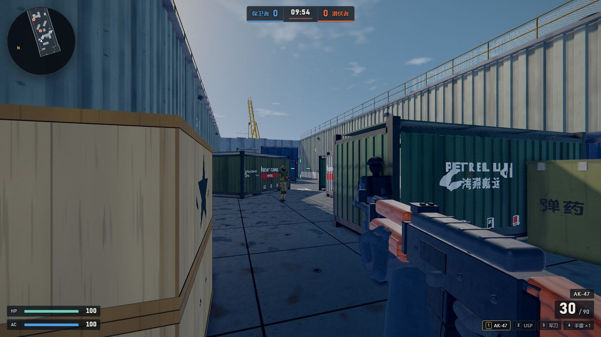
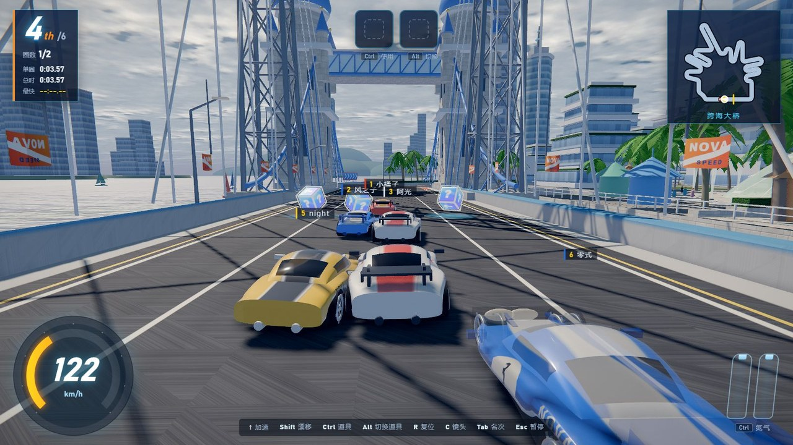
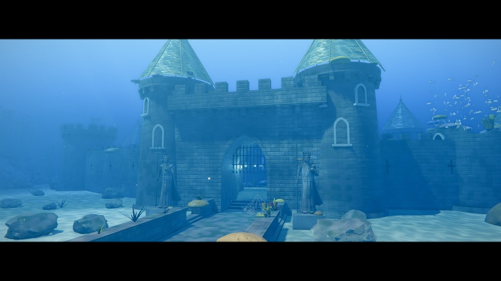

# ai-test-demo

用 AI 在浏览器里做出来的 3D 网页作品，每个文件夹是一个可以单独运行的页面。

**仓库里的内容都由 GLM-5.4 开发**（第三方库、字体和图标除外，许可写在各项目的说明里）：人只负责提需求和看效果，代码、贴图、声音、测试和文档都是模型根据一句提示词写的。每句提示词记在各自 README 的末尾。

## 五个项目

|  |  |  |  |  |
| --- | --- | --- | --- | --- |

### [运输船 · Transport Ship](cf-transport-ship/)

第一人称射击，团队竞技。照着《穿越火线》「运输船」地图的雷达图换算出来的货舱甲板：两端出生舱、两条舷侧通道、中间的集装箱场。AK-47、M4A1、AWM、两把手枪、军刀和手雷，三档难度的机器人会走位、找掩体、换弹。物理天空、海水倒影、环境光遮蔽、泛光、胶片调色，可选清晨 / 白天 / 黄昏 / 夜晚。

玩法、武器数值、地图还原了什么、已知限制，见 [cf-transport-ship/README.md](cf-transport-ship/README.md)。

### [鹈鹕骑行 · Pelican Ride](pelican-bike/)

第三人称骑行。一只戴珊瑚红头盔、系薄荷绿围巾的鹈鹕，骑着巡航车沿 807 米的环岛公路前行，上下坡、转弯、车铃、换挡。默认是写实场景 + 电影画质，按 `V` 可以切回赛璐璐（以及排线、线稿）；支持手机触屏。

操作、画风、造型工坊、已知限制，见 [pelican-bike/README.md](pelican-bike/README.md)。

### [QQ飞车 · 十一城](qq-speed/)

竞速。照着《QQ飞车》「十一城」赛道的官方小地图换算出来的 1.75 公里海滨城市赛道，从跨海大桥出发，经过 NOVA 商城、网格穹顶广场和高架。原作的键位，漂移、集气、小喷、双喷、WCW、断位双喷；竞速赛和电脑车手比圈速，道具赛有导弹、水炸弹、香蕉皮、磁铁、天使。物理天空、海水倒影、环境光遮蔽、泛光、胶片调色，可选上午 / 白天 / 午后 / 黄昏 / 夜晚。

键位、技巧、道具、赛道还原了什么、已知限制，见 [qq-speed/README.md](qq-speed/README.md)。

### [深海王城 · Sunken Castle](sunken-castle/)

潜水。四十米水下的一座王城：台地上一圈城墙和九座角塔，南门两旁是拄着三叉戟的守望者石像，城里有喷泉的前庭、带彩窗和金肋穹顶的王座厅；一条石桥跨过潟湖，四周是珊瑚花园、巨藻林、沉船、圆屋村落和断崖上的巨像。阳光折射进水里、焦散、体积光束、彩窗落在地砖上的光斑，环境光遮蔽、泛光、胶片调色，可选清晨 / 正午 / 午后 / 黄昏 / 夜晚和四档水质。

16 个镜头的电影巡游，或者自己潜泳；支持手机触屏。按键、巡游的路线、水下的光学还原了什么、已知限制，见 [sunken-castle/README.md](sunken-castle/README.md)。

### [秋千跳跳 · Swing Hop](swing-hop/)

2.5D 休闲跳跃。云海上一排浮空的小岛，每座岛上一棵树，树枝上吊着一个秋千；一只系红围巾的白兔按住蓄力、松手，从一个秋千跳到下一个。落在正中有连击加分，一路有金色秋千、宽板凳和会断的旧秋千；荡过两个秋千以后，一只踩着风暴云的狼从身后追上来，被追上这局就结束。玩法是横版的，画面是真三维：绘本黏土画风（卡通着色、随风摆的树、一层层的云），支持手机触屏。

按键、计分、难度是怎么试出来的、已知限制，见 [swing-hop/README.md](swing-hop/README.md)。

## 共同的地方

- **打开方式**：进入对应的文件夹，双击 `index.html` 就能打开。`file://` 下可用，不需要服务器，运行时不联网。
- **场景里没有素材文件**：模型、贴图、声音都是页面打开时由代码生成的（鹈鹕骑行另外带了一套品牌字体和界面图标）。
- **技术**：three.js r180，用 esbuild 打包成一个传统的 `app.js`。
- **浏览器**：需要支持 WebGL2 的近期版本 Edge 或 Chrome。鹈鹕骑行、深海王城和秋千跳跳另外支持手机触屏；运输船需要键盘和鼠标，QQ飞车需要键盘。
- **改源码**：各文件夹里 `npm install` 之后 `npm run build` 重新打包。
- **自动化检查**：五个项目都带一套 Playwright 脚本，用真实的点击和按键驱动页面逐项断言并截图，结果和没验证到的地方写在各自的 `docs/` 里。只在 Edge + RTX 3080 上跑过。
