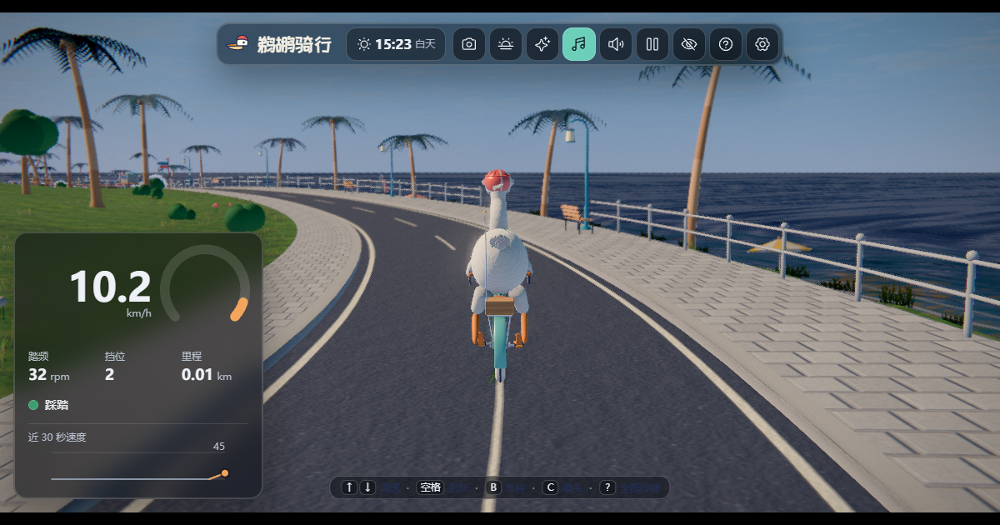

# ai-test-demo

用 AI 在浏览器里做出来的 3D 网页作品，每个文件夹是一个可以单独运行的页面。

**仓库里的内容都由 GLM-5.4 开发**（第三方库、字体和图标除外，许可写在各项目的说明里）：人只负责提需求和看效果，代码、贴图、声音、测试和文档都是模型根据一句提示词写的。每句提示词记在各自 README 的末尾。

## 两个项目

| [运输船 · Transport Ship](cf-transport-ship/) | [鹈鹕骑行 · Pelican Ride](pelican-bike/) |
| --- | --- |
|  |  |
| 第一人称射击。照着《穿越火线》「运输船」地图的雷达图换算出来的货舱甲板，团队竞技，和机器人打。 | 第三人称骑行。一只戴珊瑚红头盔、系薄荷绿围巾的鹈鹕，骑着巡航车沿环岛路前行。 |

### [运输船 · Transport Ship](cf-transport-ship/)

两端出生舱、两条舷侧通道、中间的集装箱场，致敬《穿越火线》的经典地图。AK-47、M4A1、AWM、两把手枪、军刀和手雷，三档难度的机器人会走位、找掩体、换弹。物理天空、海水倒影、环境光遮蔽、泛光、胶片调色，可选清晨 / 白天 / 黄昏 / 夜晚。

玩法、武器数值、地图还原了什么、已知限制，见 [cf-transport-ship/README.md](cf-transport-ship/README.md)。

### [鹈鹕骑行 · Pelican Ride](pelican-bike/)

807 米的环岛公路，上下坡、转弯、车铃、换挡。默认是写实场景 + 电影画质，按 `V` 可以切回赛璐璐（以及排线、线稿）；支持手机触屏。

操作、画风、造型工坊、已知限制，见 [pelican-bike/README.md](pelican-bike/README.md)。

## 共同的地方

- **打开方式**：进入对应的文件夹，双击 `index.html` 就能玩。`file://` 下可用，不需要服务器，运行时不联网。
- **场景里没有素材文件**：模型、贴图、声音都是页面打开时由代码生成的（鹈鹕骑行另外带了一套品牌字体和界面图标）。
- **技术**：three.js r180，用 esbuild 打包成一个传统的 `app.js`。
- **浏览器**：需要支持 WebGL2 的近期版本 Edge 或 Chrome。鹈鹕骑行另外支持手机触屏；运输船需要键盘和鼠标。
- **改源码**：各文件夹里 `npm install` 之后 `npm run build` 重新打包。
- **自动化检查**：两个项目都带一套 Playwright 脚本，用真实的点击和按键驱动页面逐项断言并截图，结果和没验证到的地方写在各自的 `docs/` 里。只在 Edge + RTX 3080 上跑过。
