# 运输船 · Transport Ship

一艘集装箱船的货舱甲板：两端是出生舱，两侧各一条舷侧通道，中间是集装箱场。你和一队机器人对抗另一队机器人，团队竞技，先到目标击杀数的一方获胜。

致敬《穿越火线》经典地图「运输船」的同人练习作品，和官方无关。地图布局按游戏里的雷达俯视图换算，**写实的 3D 场景 + 电影画质**：物理天空、PBR 材质、海水倒影、环境光遮蔽、泛光、胶片调色、镜头光晕。

整条船、每个士兵、每把枪、所有贴图和所有声音都由代码在浏览器里**即时生成**：没有模型文件、没有图片素材、没有音频文件，页面运行时不联网。

**本项目由 GLM-5.4 开发**：场景、玩法、渲染、音频、界面、测试和这份说明都是模型根据提示词写的，人只负责提需求和验收。提示词见文末的[「开发过程与提示词」](#开发过程与提示词)。

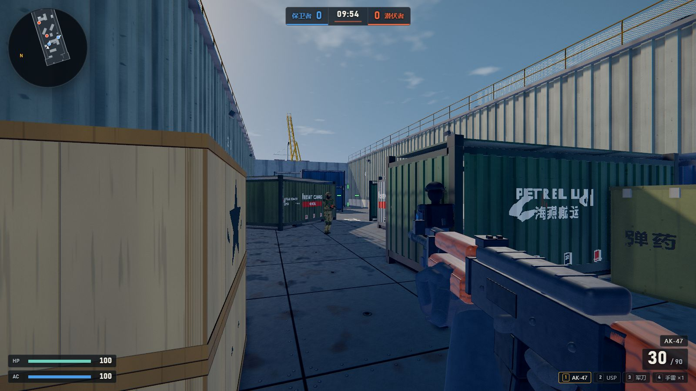

## 运行截图

都是正式页面（双击 `index.html`）的实际运行画面：`python tools/qa/gallery.py` 用调试接口把对局定位到对应状态后自动截取，没有后期修图。原图在 `docs/gallery/`。

| 大厅 | 主甲板 · AK-47 |
| --- | --- |
| 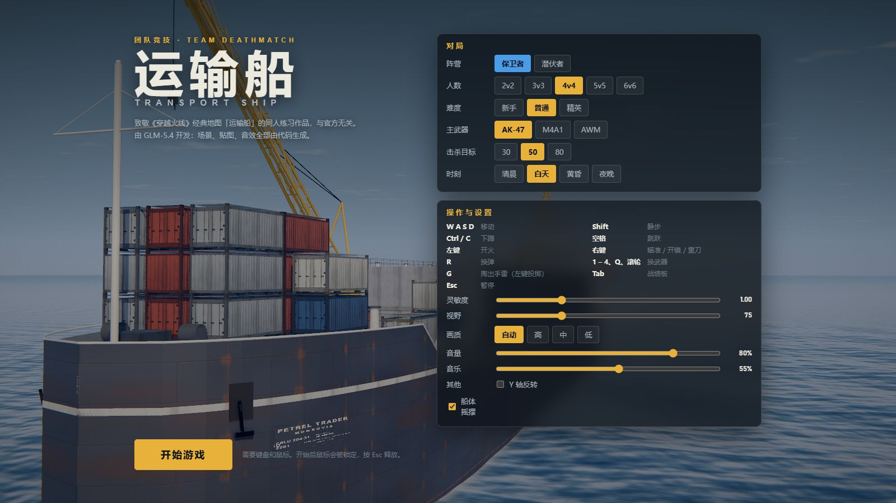 |  |
| **瞄准连发** | **AWM 开镜** |
| 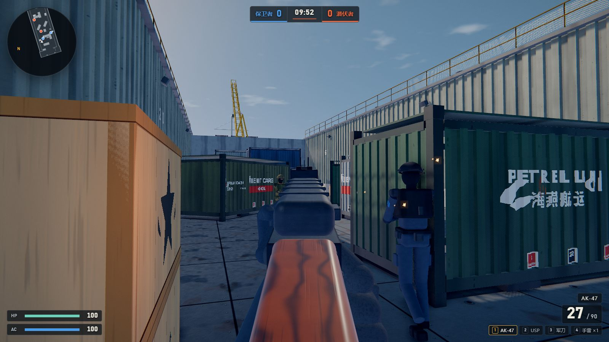 | 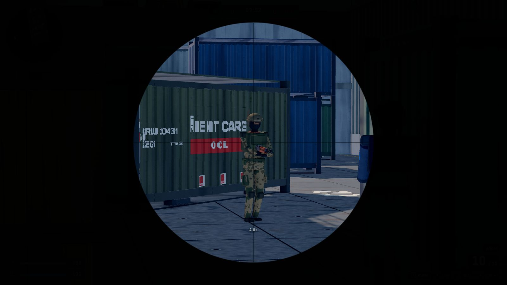 |
| **潜伏者 · M4A1** | **战绩板** |
| 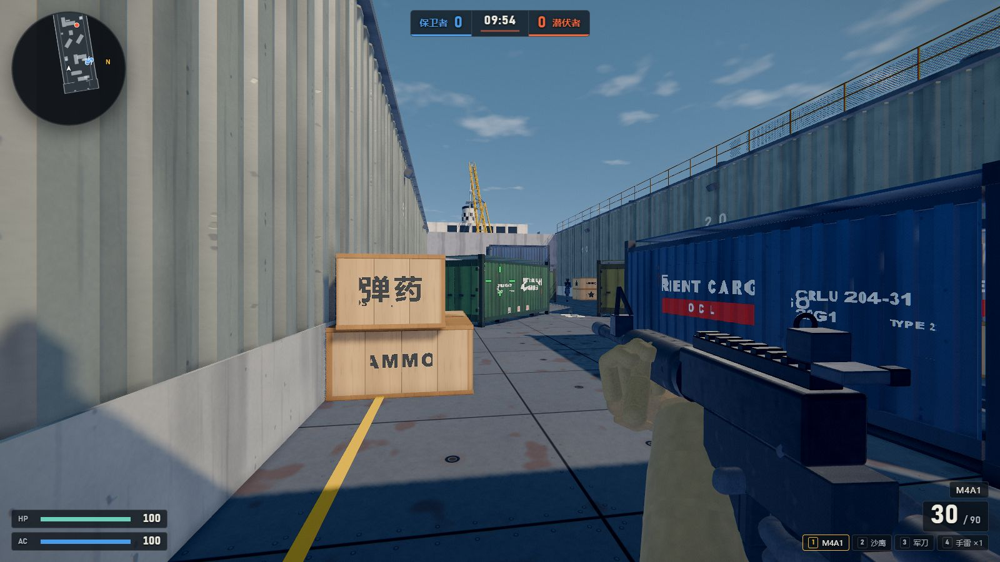 | 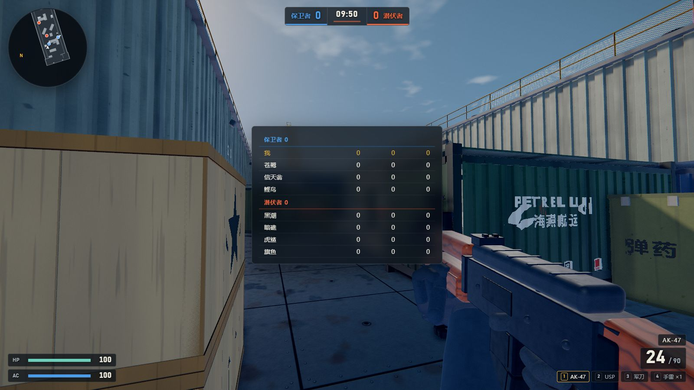 |
| **阵亡** | **结算** |
| 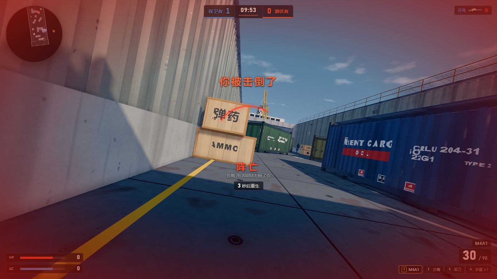 | 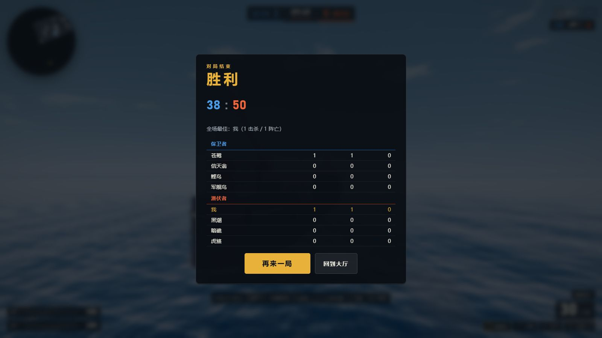 |

时刻可以选清晨、白天、黄昏、夜晚：

| 黄昏 | 夜晚 |
| --- | --- |
| 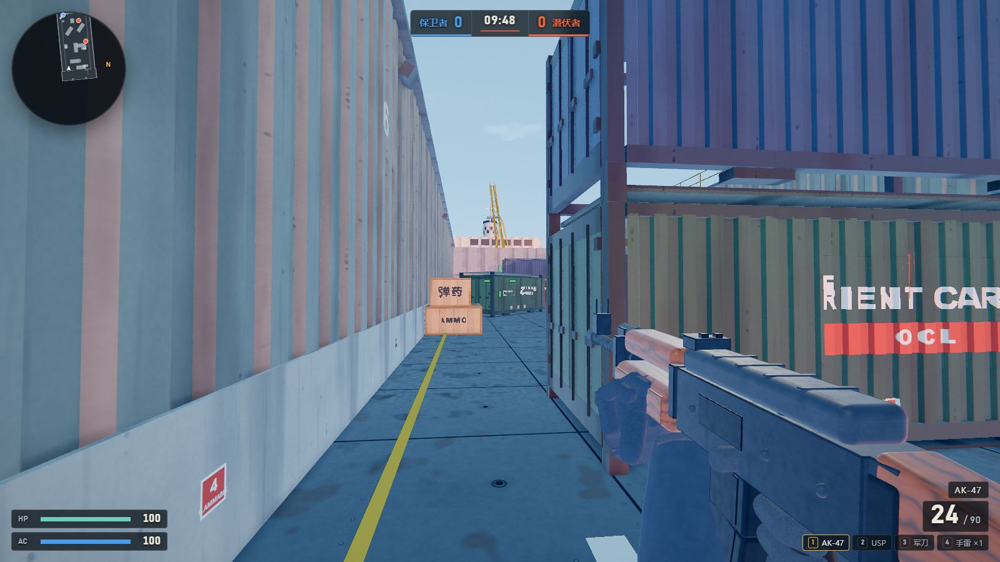 | 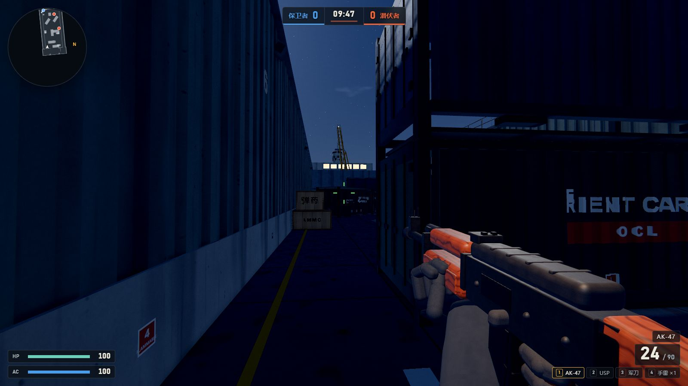 |
| **清晨** | **货舱俯瞰** |
| 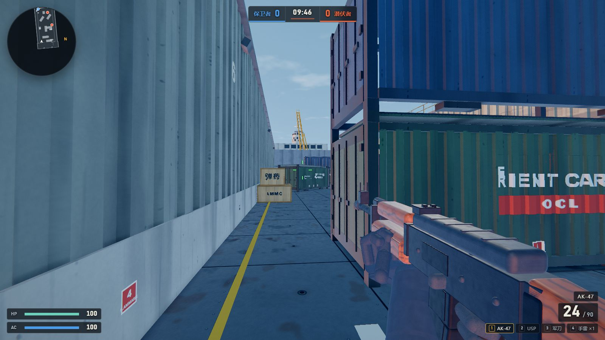 | 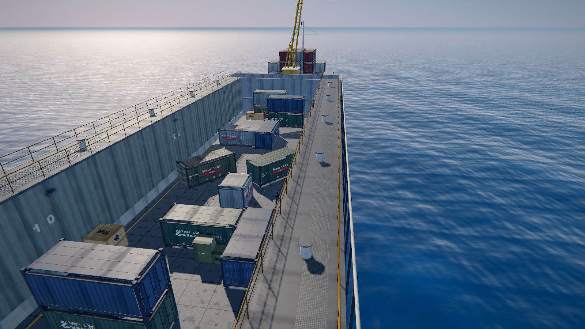 |

| 整条船 | 枪模图鉴（腰射 · 瞄准 · 侧后方） |
| --- | --- |
| 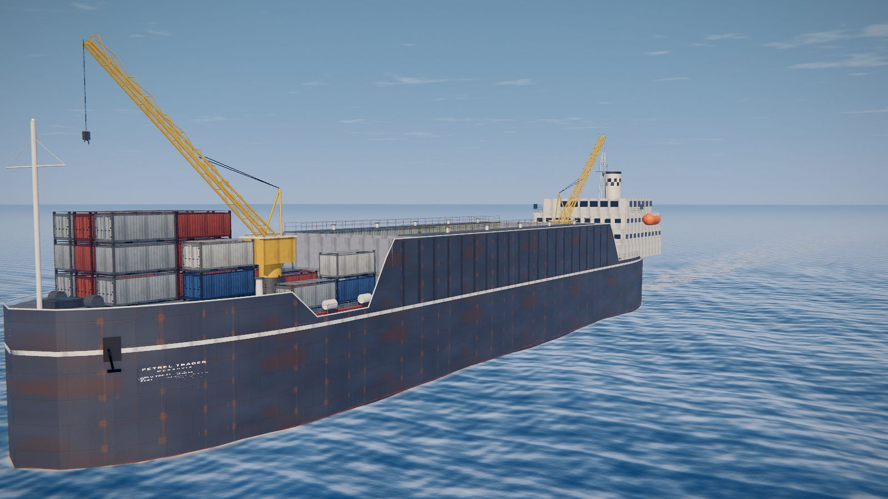 | 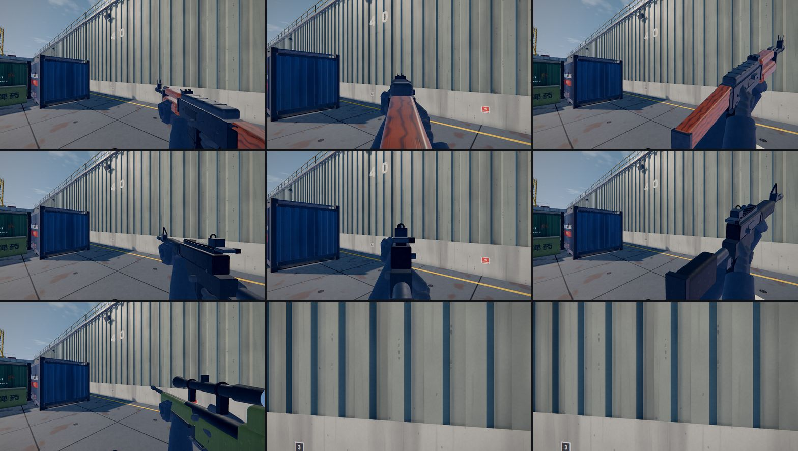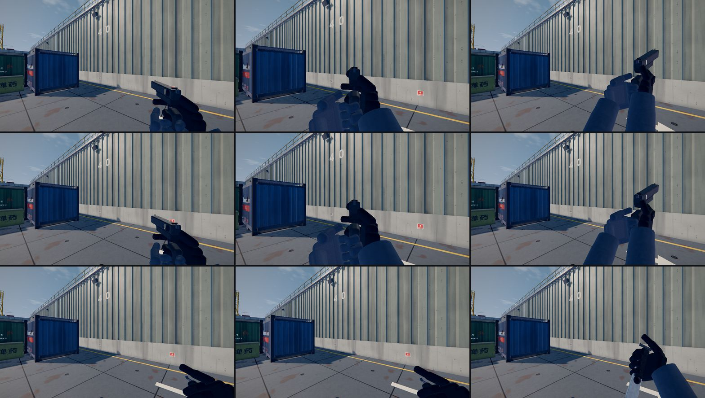 |

## 打开方式

**直接双击 `index.html`** 就能打开（`file://` 下可用，不需要服务器，不需要联网）。

或者起一个本地服务器（改动源码后调试时更方便）：

```bash
npm run dev        # 零依赖静态服务器 → http://127.0.0.1:5173
```

浏览器要求：支持 WebGL2 的近期版本 Edge 或 Chrome（只在 Edge 上测过）。需要键盘和鼠标，不支持触屏。

## 怎么玩

| 操作 | 作用 |
| --- | --- |
| `W` `A` `S` `D` | 移动 |
| 鼠标 | 转视角（点一下画面锁定鼠标；拿不到锁定时改成按住画面拖动） |
| 左键 | 开火；军刀轻划；手雷投掷 |
| 右键 | 瞄准；AWM 开镜（右键依次切 4 倍 → 8 倍 → 收镜）；军刀重击 |
| `R` | 换弹 |
| `1` `2` `3` `4` | 主武器 / 手枪 / 军刀 / 手雷 |
| `Q`、滚轮 | 上一件武器 / 循环切换 |
| `G` | 直接掏出手雷 |
| `Shift`（按住） | 静步（慢，声音小） |
| `Ctrl` 或 `C`（按住） | 下蹲 |
| `空格` | 跳跃（0.95 米高的箱子能直接跳上去） |
| `Tab`（按住） | 战绩板 |
| `Esc` | 暂停 |

**规则**：团队竞技，10 分钟，先到 30 / 50 / 80 杀的一方获胜（时间到了按比分）。阵亡 3 秒后在己方舱里重生，重生后有 2 秒保护，一开枪就取消。头部伤害 ×4，腹部 ×1.25，腿 ×0.75；护甲替你分担 28% 的伤害。

**大厅里能选**：阵营（保卫者 / 潜伏者）、人数（2v2 到 6v6）、难度（新手 / 普通 / 精英）、主武器（AK-47 / M4A1 / AWM）、击杀目标、时刻、灵敏度、视野、画质（自动 / 高 / 中 / 低）、音量。设置存在浏览器里。

| 武器 | 伤害 | 射速 | 弹匣 / 备弹 | 换弹 | 说明 |
| --- | --- | --- | --- | --- | --- |
| AK-47 | 36 | 600 发/分 | 30 / 90 | 2.45 秒 | 伤害高，后坐大 |
| M4A1 | 31 | 690 发/分 | 30 / 90 | 2.30 秒 | 后坐小 |
| AWM | 118 | 44 发/分 | 10 / 30 | 3.10 秒 | 打一枪拉一次栓（1.25 秒），4 倍 / 8 倍镜 |
| 沙漠之鹰 | 54 | 300 发/分 | 7 / 35 | 2.05 秒 | 潜伏者的手枪 |
| USP | 30 | 420 发/分 | 12 / 48 | 1.90 秒 | 保卫者的手枪 |
| 军刀 | 68 / 150 | — | — | — | 轻划 / 重击 |
| 高爆手雷 | 98 | — | 1 颗 | — | 半径 7.5 米，扔出后约 3 秒爆炸，会反弹，隔墙伤害大减 |

**界面**：雷达（队友常显，敌人被看见或开枪时才显影）、比分和倒计时、击杀播报（带枪的图标和爆头标记）、随散布张合的准星、命中标记、受击方向、连杀横幅（首杀、爆头、双杀、三杀……）、血量护甲、弹药和武器槽、阵亡倒计时、战绩板、结算画面。

## 地图还原了什么

布局是按游戏内雷达俯视图量的（按舱门、集装箱等参照物估算比例，约 0.19 米/像素），再用游戏截图核对的：

- 货舱约 **63 米 × 21 米**。两端各一个 6 米深的出生舱，大门洞 7.2 米宽、带黄漆门框。
- 主甲板宽 15.4 米，两侧各一条 **2.2 米宽的舷侧通道**：北通道左端是死路、通向船头舱；南通道右端是死路、通向船尾舱。整张图是一个环。
- 中间 **10 个集装箱位**：贴着两端的立箱（其中三处叠了两层）、左边的“靴形”、右边的“L 形”、中路一只 10 尺小箱、**两只 39.5° 的斜箱**。
- 木箱和铁箱：左侧“靴形”腿旁边 0.95 → 1.8 米 → 箱顶 2.59 米的三级台阶，北墙和右“L”形角上的双层木箱，东南角的矮箱平台，两端的弹药箱。

**这些是自创的，不是原版的**：集装箱上的航运公司标志和编号（“海燕航运”“ORIENT CARGO”）、舱牌、广告横幅、弹药箱上的喷字；出生舱里的摆设；船体外观（驾驶室、烟囱、吊机、桅杆、救生艇）是按截图和一般集装箱船的样子搭的。原版的贴图、模型、图标一个都没有用，所以走近看集装箱的涂装、墙面的编号和原版并不一样。

## 它是怎么做的

- **写实的渲染**：大气是物理模型——JS 积分出透射率查找表，GLSL 沿视线算内散射，烘焙成一张 HDR 等距柱状图，同时当天空、环境光照（PMREM）和海面的反射源用；太阳 / 月光颜色、雾色、天光强度都从同一套模型算出来。海面是两层法线贴图加平面镜像相机画出的真实倒影。后期是 HDR 多重采样 → 环境光遮蔽 → 泛光 → AgX 色调映射 → 分离色调、锐化、暗角、胶片颗粒、色差、镜头光晕。整条船连同船上的人一起轻轻横摇、起伏。
- **全程序化的贴图**：甲板钢板、漆面、裸金属、船壳、木纹、布料、枪用的烤蓝钢 / 层压木 / 皮革，都是逐像素烘出来的一套 PBR 贴图（颜色、法线、遮蔽·粗糙度·金属度），颜色走顶点色，所以一套“漆面”能画出黄的栏杆、灰绿的舱壁和各色集装箱。标志和文字是在 Canvas 上排好再贴上去的。
- **静态合批**：船和货舱的几百个部件按材质合成十几个网格，集装箱用实例化，所以整帧只有 130–240 次绘制。
- **第一人称枪模**：7 件武器和握着它们的手是圆角盒、圆柱、球拼的（倒角的棱边上有高光），带一套密得多的枪用贴图。枪模画在一个单独的场景里，用比世界窄的视野（不会拉变形），有自己的灯光：太阳（镜头进了船的阴影就熄掉）、天光、补光、轮廓光，夜里还有舱灯色的点光。枪口焰和枪画在同一个场景里，位置对得上。
- **士兵**：程序化建模 + 17 根骨骼的蒙皮 + 程序动画（走跑、下蹲、瞄准俯仰、后坐、中弹、倒地）。一个人是一个蒙皮网格，两队配色不同。
- **射击**：射线命中，分头（球）、胸腹、腿（圆柱）几个部位；有距离衰减、部位倍率、护甲分担；后坐是镜头冲击加留在准星上要自己压的一部分，散布随连发和移动变大。
- **机器人**：感知（视场、视线遮挡、听枪声脚步）→ 状态机（游走 / 追击 / 交战 / 撤退找掩体）→ 1 米栅格上的 A* 寻路。难度调的是反应时间、瞄准误差、连发纪律、伤害和视野。会换弹、子弹打光换手枪、边打边横移、血少时退到掩体后面。
- **手雷**：沿速度方向逐步推进，撞到东西按法线反弹，爆炸时逐个人检查遮挡。
- **声音**：全部用 WebAudio 现场合成——每种枪的枪声、换弹的三个动作、弹着、子弹擦过、脚步、受击、连杀音效、大厅音乐，还有海浪、风和主机低鸣的环境声。带 HRTF 的方位感、距离衰减、合成出来的船舱混响。
- **电影画质里没有用景深**：第一人称里它只会把枪和近处糊掉。

## 目录

```
cf-transport-ship/
├─ index.html、styles.css     页面和界面样式
├─ app.js                     打包产物（压缩版），页面只加载它
├─ src/
│  ├─ main.js                 入口：启动、模式切换、主循环、调试接口
│  ├─ core/                   纯逻辑：地图数据、武器数值、规则、碰撞、寻路、射线命中、数学、大气模型、音频合成基础
│  ├─ gfx/                    渲染舞台、后期、天空、贴图烘焙、静态合批
│  ├─ world/                  船、货舱甲板、集装箱和箱子、海、天空、材质
│  ├─ actors/                 枪模和手、枪用贴图、士兵
│  ├─ game/                   对局、武器、机器人、第一人称枪模、特效、声音、输入
│  └─ ui/                     战斗界面、大厅 / 暂停 / 结算
├─ tools/qa/                  自动化检查和截图脚本
├─ docs/gallery/              运行截图；docs/evidence/ 检查结果；docs/validation-report.md 验证报告
└─ licenses/three.js.txt
```

## 开发与验证

```bash
npm install                 # 只有重新打包时需要（three + esbuild）
npm run build               # 开发版 app.js（带 sourcemap）
npm run prod                # 压缩版 app.js
npm run dev                 # 本地服务器 http://127.0.0.1:5173

npm test                    # 纯逻辑检查（寻路、射线命中、武器节奏、机器人），不需要浏览器
python tools/qa/app_check.py   # 端到端验收 108 项：真实按键鼠标事件驱动页面，逐项断言并截图
python tools/qa/soak.py        # 浸泡：真实时间跑一局、乱按一分钟，查报错 / NaN / 粒子不消散 / 资源泄漏
python tools/qa/perf.py        # 每个画质档、每种分辨率的单帧耗时
python tools/qa/gallery.py     # 重新生成上面的运行截图
```

Python 脚本需要 Playwright 和系统里的 Edge（`pip install playwright pillow`）。页面还有一些 URL 参数用来定位状态：`?auto=1` 跳过大厅、`hour=22` 时刻、`team=1` 阵营、`primary=awm` 主武器、`size=6` 人数、`diff=hard` 难度、`quality=0..2` 画质、`seed=7` 固定这一局的随机数。

## 验证结果与已知限制

在本机（RTX 3080，Windows 11，无头 Edge）上实际跑过的：

- 纯逻辑检查 22 项、端到端验收 108 项全部通过；60 秒乱按的浸泡测试没有页面报错、没有 NaN、粒子正常消散、来回切暂停 / 大厅 / 开局后显存里的几何和贴图数量不涨。
- 单帧渲染耗时（含阴影、海水倒影、全部后期）：1280×720 和 1920×1080 下高档都是 5 毫秒上下。
- 启动到大厅约 3.8 秒，其中两秒左右是显卡编译着色器——这一段放在加载界面后面，大厅一出来就是流畅的。

**没验证的**：只在 Edge + 这一张显卡上跑过（主要是无头模式，另在真实窗口里跑了十几秒），Firefox、Safari、别的显卡都没测；**本地显示器上的帧率没有量过**——测试时这台机器是通过远程桌面连着的，远程显示器的刷新率是 32 Hz，浏览器里的帧率最高就是 32（大厅也一样），所以拿得出手的只有单帧渲染耗时；声音没有听过，音色和响度没有经过耳朵；鼠标手感、难度是否合适这些只能人来判断。

**做不到的**：

- 模型全是代码拼的：士兵和枪近看比商业游戏简单得多，没有面部、手指是分节的手套，没有动作捕捉。
- 机器人是脚本 AI，会走位、找掩体、换弹，但不会配合战术。
- 只有团队竞技一种模式，只能和机器人打，没有联网，没有经济 / 买枪，武器不能配配件。
- 地图的尺寸是按图换算的，和原版会有出入；原版的贴图、标志、数值都没有用（也拿不到），武器和规则数值是按常见设定给的。
- 连杀按“一条命里不死就接着数”算，没有找到官方的判定说明。

细节和逐项结果见 [docs/validation-report.md](docs/validation-report.md)。

## 开发过程与提示词

**本项目由 GLM-5.4 开发。** 模型在命令行编码代理里工作：自己读写文件、打包、跑测试、启动浏览器截图并逐张检查，再写验收脚本和这份文档。人只做两件事——提需求、看效果。仓库里这个目录的内容（第三方库 three.js 除外，见下面的版权与声明）都是 GLM-5.4 写的。

提示词只有这一句：

> 再开发一个，尽可能真实的还原穿越火线中的运输船地图，我需要一个真实的枪战游戏，生成一个3d页面，尽可能发挥你的所有能力，使用3d写实场景，还有电影画质。

之后人只补了三句话：「放在仓库的cf-transport-ship目录下。」「帮我将这个提交到仓库中，然后参考鹈鹕骑车的readme，加入readme文档」「还需要说明是glm-5.4开发」。其余就是几次「继续」，没有再给设计意见。

顺序是：先照着游戏里的雷达图和截图量出布局，再搭渲染和船体，然后是射击、机器人、界面、声音，最后是自动化检查和一轮画面打磨。中途修掉的问题和仍然不足的地方都记在验证报告里。

## 版权与声明

《穿越火线》、「运输船」地图及相关名称的权利归 Smilegate / 腾讯所有。这是一个非商业的同人练习作品，和权利方没有关系。

从原作借用的只有三样：地图名和它的布局、两队的名字「保卫者 / 潜伏者」、团队竞技的玩法。原作的图片、模型、音频、代码、角色一样都没有用；页面里出现的航运公司、标志、编号、文字和机器人的代号都是虚构的。

[three.js](https://threejs.org/) 以 MIT 协议使用，版权声明见 `licenses/three.js.txt`。
