# 鹈鹕骑行 · Pelican Ride

一只戴珊瑚红头盔、系薄荷绿围巾的白鹈鹕，骑着薄荷绿巡航车沿环岛路前行。海在右手边，车筐里装着鱼，车尾挑着一面三角旗。

默认是**写实场景 + 电影画质**：物理天空与大气、PBR 材质、海水倒影、景深、泛光、胶片调色、2:1 黑边。按 `V` 可以一键切回原来的赛璐璐（以及排线、线稿）。

整座岛、这只鸟、所有贴图和所有声音都由代码在浏览器里**即时生成**：没有模型文件、没有图片素材、没有音频文件，页面运行时不联网。

**本项目由 GLM-5.4 开发**：场景、渲染、音频、界面、测试和这份说明都是模型根据提示词写的，人只负责提需求和验收。用到的提示词原文见文末的[「开发过程与提示词」](#开发过程与提示词)。

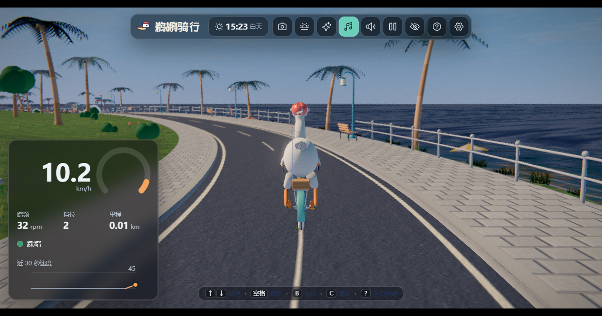

## 运行截图

都是正式页面（双击 `index.html`）的实际运行画面：`python tools/qa/gallery.py` 用 URL 参数把页面定位到对应状态后自动截取，原图在 `docs/gallery/`。

| 白天 · 跟拍（默认画面） | 黄昏 · 侧跟（`2`） |
| --- | --- |
| 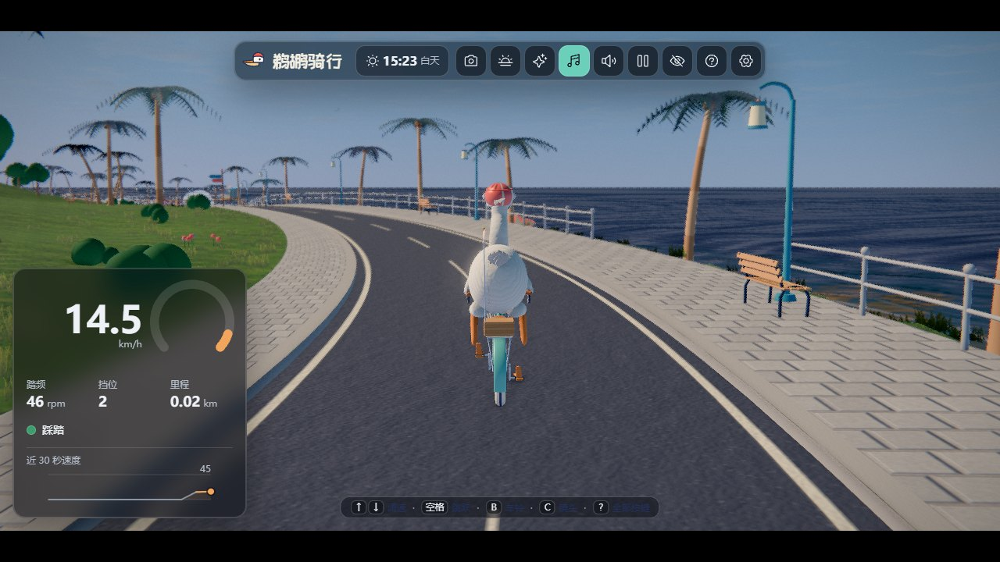 | 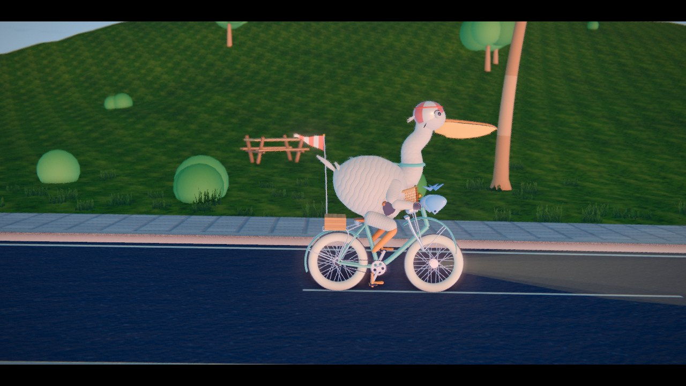 |
| **特写（`3`）** | **黄昏逆光 · 特写** |
| 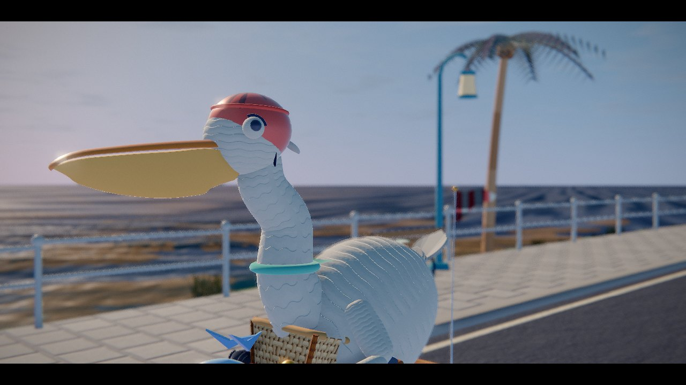 | 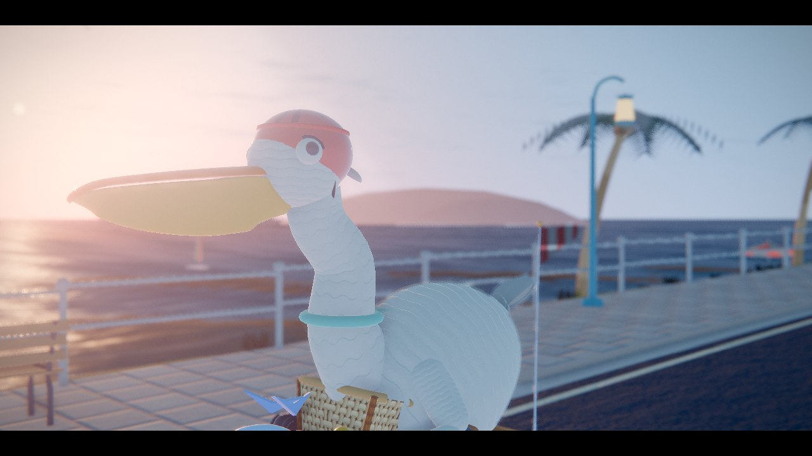 |
| **夜晚（`T` 切换时刻）** | **清晨** |
| 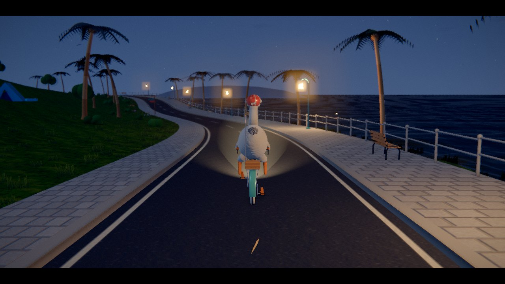 | 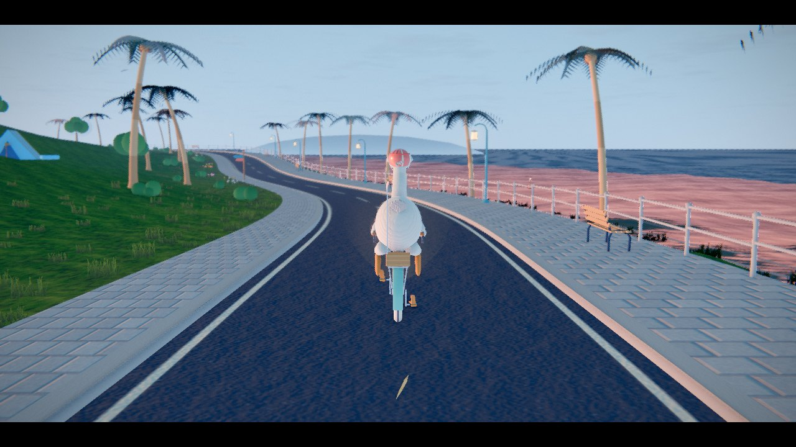 |
| **环绕（`4`）** | **设置面板** |
| 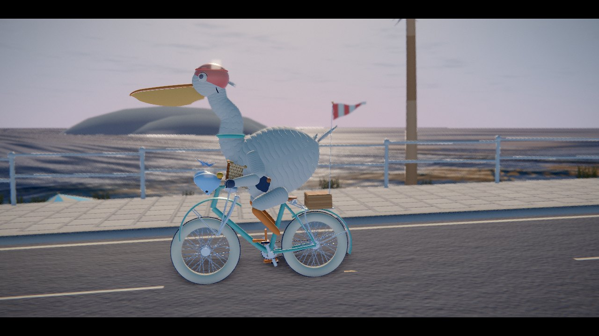 | 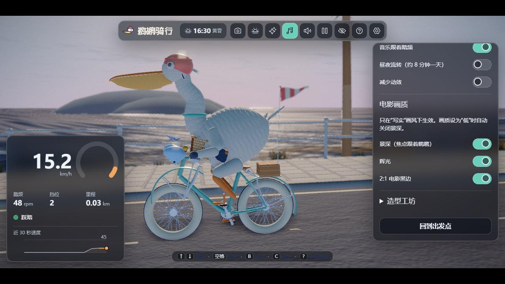 |

同一个画面按 `V` 在四种画风之间循环：

| 写实（默认） | 赛璐璐 |
| --- | --- |
| 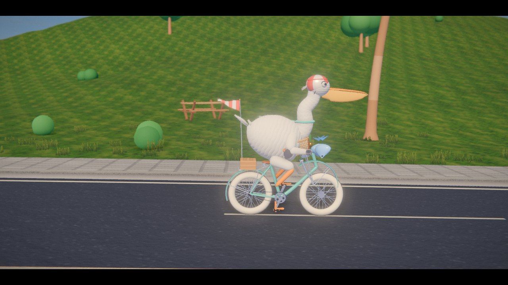 | 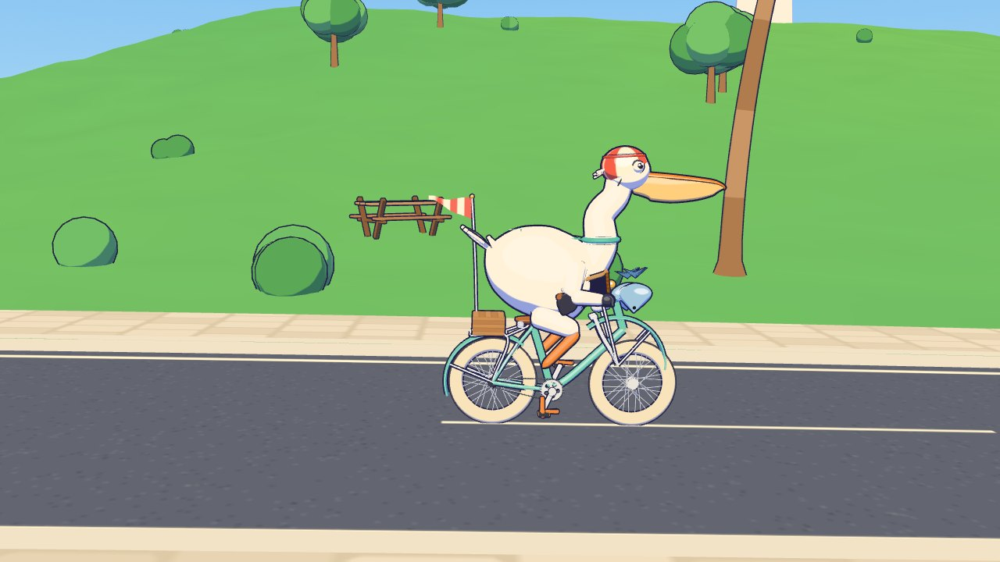 |
| **排线** | **线稿** |
| 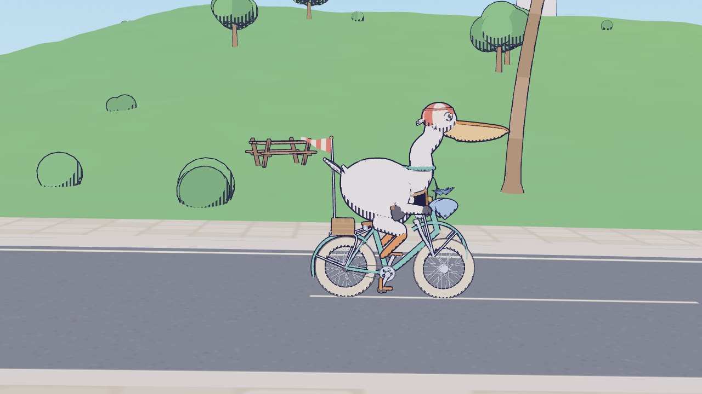 | 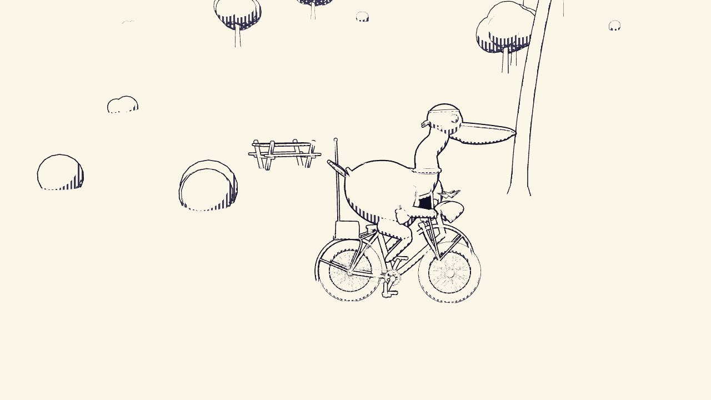 |

| 手机竖屏（触屏按钮） |
| --- |
| 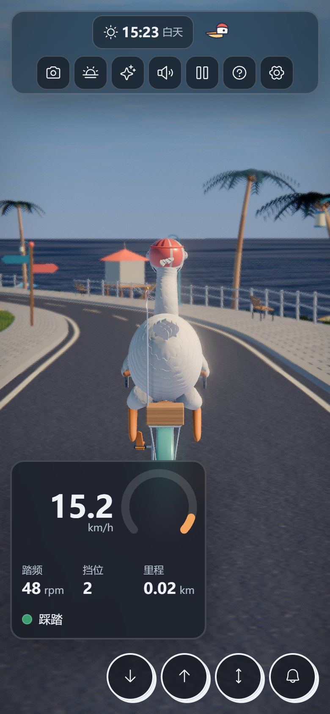 |

## 打开方式

**直接双击 `index.html`** 就能打开（`file://` 下可用，不需要服务器，不需要联网）。

或者起一个本地服务器（改动源码后调试时更方便）：

```bash
npm run dev        # 零依赖静态服务器 → http://127.0.0.1:5173
```

浏览器要求：支持 WebGL2 的近期版本 Edge、Chrome、Firefox 或 Safari。

## 怎么玩

| 操作 | 作用 |
| --- | --- |
| `↑` / `W`、`↓` / `S`（按住） | 加速 / 减速刹车，0–45 km/h |
| `空格` | 跳一下 |
| `B` | 按车铃，会惊飞附近的海鸥 |
| `G` | 换挡（三速花鼓） |
| `C` 或 `1`–`6` | 切换镜头：跟拍 / 侧跟 / 特写 / 环绕 / 导演 / 鹈鹕视角 |
| `T` / `Y` | 切换时刻（清晨、白天、黄昏、夜晚）/ 昼夜流转 |
| `V` | 切换画风：写实（电影画质）/ 赛璐璐 / 排线 / 线稿 |
| `K` 或点鹈鹕 | 它会看着镜头叫一声 |
| 点海面 | 鱼跃出水面 |
| `N` / `M` | 音乐开关 / 静音 |
| `P` | 暂停，再按继续 |
| `H` | 隐藏界面，只看画面 |
| `X` | 显示骨架与踏频轨迹 |
| `R` | 回到出发点 |
| 拖动 / 滚轮（双指） | 环绕视角 / 远近 |
| `?` | 完整的按键说明 |

设置面板里可以调目标速度、描边粗细、画质、音量、音乐、昼夜流转、减少动效；写实画风下还有「电影画质」开关（景深、辉光、2:1 黑边）。「造型工坊」里喙长、喉囊深度、脖子长度、体型都能拖动，几何会实时重建。

## 它是怎么做的

- **程序化建模**：鹈鹕的躯干、颈、喙、喉囊、四肢都是沿样条曲线放样的椭圆截面（上下不对称，才能做出喉囊和肚皮），头和眼睛是变形球体，头盔是带贴图的球冠。自行车是管、放样挡泥板、带齿的链轮和 32 根辐条。
- **运动学同源**：速度是唯一的权威状态。曲柄角、踏频、车轮转角、链条位移、镜头视野、音乐节拍全部由它导出。双腿和双翅是解析双骨 IK，脚固定在踏板上、翅尖握在把套上。
- **次级动画**：头部相对躯干做弹簧滞后，喉囊在落地时晃动，围巾是带抗弯刚度的 Verlet 布料，尾旗是行波。
- **写实渲染（默认画风）**：大气是物理模型——JS 暴力积分出一张透射率查找表（球面地球，含地球阴影和臭氧，所以有曙暮光），GLSL 沿视线做内散射，烘焙成一张 HDR 等距柱状图，同时当天空、环境光照（PMREM）和海面反射用；太阳 / 月光颜色、雾色、天光辐照度都从同一套模型算出来。每个赛璐璐材质按固有色查表得到 PBR 对应物（粗糙度、金属度、清漆、绒毛），合批网格带逐顶点材质参数。海面是两层法线贴图 + 菲涅尔 + 镜像相机画出的真实倒影 + GGX 粲光。地表是按世界坐标投影的程序贴图（草地、沙地、陡坡岩石、沥青、步道砖），路两侧撒了四千多丛草，棕榈在这种画风下换成沿叶轴排列的小叶卡片。
- **电影后期**：HDR 多重采样渲染 → 环境光遮蔽 → 泛光 → 景深（焦点跟着鹈鹕）→ AgX 色调映射 → 分离色调、锐化、暗角、胶片颗粒；画面按 2:1 加黑边，界面换成深色玻璃。
- **赛璐璐渲染**：自定义着色器做三阶色阶（阴影是固有色向蓝紫色偏，不是灰度相乘）、色阶边界用屏幕导数抗锯齿、反面外扩描边（1.5–2 px，随距离淡出）、夜间路灯和车灯以局部光源槽投影到地面。
- **世界**：807 米的闭合环线，地形高度是唯一的权威函数；路面、步道、路缘石沿路线生成；道具按弧长分成 24 段合批，每段一次绘制；海面是覆盖到地平线的非均匀网格，方向波叠加，带岸沫和碎金；天空是渐变穹顶，外加几何云和远岛。
- **音频**：全部由 WebAudio 合成。铃声、叫声、水花、落地都是实时合成的；音乐是前瞻调度的生成式拨弦，节拍跟随踏频。

## 目录

```
index.html        页面结构（语义化 HTML）
styles.css        界面样式
fonts.css         品牌字子集（base64 内嵌，由工具生成）
app.js            打包产物（src/ + three.js，传统 <script>，file:// 可直接加载）
src/
  main.js         总装入口
  core/           纯逻辑：骑行仿真、自行车运动学、IK、布料、调色盘、路线、大气模型、写实时刻（有单元测试）
  gfx/            渲染：toon 材质与描边、写实层（大气烘焙、材质分类、PBR、后期链、平面反射）、放样、舞台、程序化贴图
  actors/         自行车、鹈鹕、骑手
  rig/            相机、输入、路线安放
  world/          天空、海、地形、草丛、道具、地标、总装
  audio/          WebAudio 引擎
  ui/             界面逻辑与图标
tests/            node:test 单元测试
tools/            构建、字体与图标生成、QA 截图与验收脚本
docs/             设计系统、场景规格、验收报告；evidence/ 是测试日志，screenshots/ 是证据截图，gallery/ 是上面「运行截图」的原图
assets/fonts/     字体子集与许可证
assets_src/       字体与界面图标的源文件（附许可证）
licenses/         第三方许可证全文（three.js）
```

## 开发命令

```bash
npm run build      # 开发版打包（可读 + sourcemap）→ app.js
node build.mjs --prod   # 压缩版
node build.mjs --watch  # 监听重建
npm test           # node --test tests/
```

首次改源码前需要安装依赖（运行页面不需要）：`npm install`（three@0.180.0 与 esbuild）。

QA（需要 Python 3、Playwright 及其 Edge 通道）：

```bash
python tools/qa/app_check.py      # 端到端验收：真实点击与按键，64 项断言 + 截图
python tools/qa/mobile_shots.py   # 手机竖屏 / 横屏（触屏仿真）截图
python tools/qa/gallery.py        # 重出上面「运行截图」里的图（docs/gallery/）
python tools/qa/perf_breakdown.py  # 写实画风每帧耗时拆解（倒影 / 景深 / 遮蔽 / 辉光各占多少）
python tools/qa/soak.py           # 浸泡测试：5 分钟随机操作 + 反复重建，查泄漏与 NaN
node tools/qa/world_node_check.mjs   # 不开浏览器：在 Node 里构建世界与骑手，查几何体里有没有非法数值
python tools/qa/shot.py --name a --js "__ride.setView('sideSea')"   # 单张截图
python tools/qa/world_shots.py --views overview behind lighthouse   # 世界检视台
```

页面暴露 `window.__ride` 调试接口（`state()`、`settle(n)`、`setView(name)`、`cam(id)`、`hour(h)`、`style(i)`、`stats()` 等），URL 参数可用于直接进入某个状态，例如 `index.html?intro=0&hour=18.2&cam=director&style=1`（`style` 0 = 写实、1 = 赛璐璐、2 = 排线、3 = 线稿）。

## 已验证与已知限制

在正式包上：单元测试 30 项、端到端验收 64 项（真实点击与按键，含手机竖屏的触屏布局）、浸泡测试 15 项（5 分钟随机操作、反复重建）全部通过，详见 [docs/validation-report.md](docs/validation-report.md)。设计决策见 [docs/design-system.md](docs/design-system.md)。

- 声音的**听感**无法自动化验证：音量平衡和音色请自己听一遍，设置里可以调。
- 写实画风在本机（RTX 3080，无头 Edge，1280×720，“高”档）量得每帧约 7–9 ms，其中倒影约 1.5 ms、遮蔽约 0.7 ms、辉光约 0.5 ms；赛璐璐画风约 2.5–6 ms（720p 到 4K）。低端核显上的表现没有实测，页面会按实测的单帧成本自动降档（“低”档关掉遮蔽、景深、多重采样和海水倒影）。
- 写实画风里的鹈鹕和自行车还是那套程序化放样几何，只是换成了物理材质（羽毛法线、清漆车漆、铬、橡胶）。造型的写实程度受几何本身限制，特写镜头下仍然偏卡通。
- 夜晚是“电影式夜景”：月光比真实亮得多，夜空留了底光，否则什么都看不见。
- 派出的独立代码审查代理因 API 用量上限没能完成，只有作者自己的定向自查。
- 只在 Edge（Chromium 158）上做过自动化验收，Firefox 和 Safari 没有实测。
- 太阳的方位与时刻的对应关系是**艺术设定**，不是天文模型；但大气散射、直射光颜色、曙暮光是物理模型，黄昏到夜晚的过渡（天光熄灭、蓝调时刻、星星出现）是算出来的。
- 围巾、尾旗和海的波动是表现性的，不是物理仿真结果。

## 开发过程与提示词

**本项目由 GLM-5.4 开发。** 模型在命令行编码代理里工作：自己读写文件、打包、跑单元测试、启动无头浏览器截图并逐张检查，再写验收脚本和文档。人只做两件事——提需求、看效果。仓库里的内容（第三方字体和图标除外，见文末致谢）都是 GLM-5.4 写的。

下表是这个项目用到的人工输入，原文照录（包括错别字），没有改写。

| 时间（2026-11-24） | 模型 | 提示词 | 得到了什么 |
| --- | --- | --- | --- |
| 09:26 | GLM-5.3 | 生成一个鹈鹕骑自行车的 3D 页面，尽可能把你所有的能力全部都用上, 本机的blender-mcp可以使用 | 第一次尝试：用 Blender 建模、导出 GLB 再放进网页 |
| 10:04 | GLM-5.3 | 你自己看下当前效果，太差了，不要使用blender了使用thressjs实现， | 这一版被否掉 |
| 12:00、13:42 | GLM-5.4 | 生成一个鹈鹕骑自行车的 3D 页面，尽可能把你所有的能力全部都用上. | 换模型后在同一个目录从头重做：纯 Three.js 程序化建模的赛璐璐版（这条发了两次） |
| 15:14、15:38、16:54、18:09 | GLM-5.4 | 继续 | 接着做没做完的部分：世界、音频、验收、文档 |
| 19:45 | GLM-5.4 | 启动我看看 | 在浏览器窗口里打开页面 |
| 19:52 | GLM-5.4 | 修改为3d写实场景，还有电影画质。 | 默认画风改为写实 + 电影画质；赛璐璐 / 排线 / 线稿保留，按 `V` 切换 |
| 22:28 | GLM-5.4 | 继续 | 完成写实版的验收和文档 |
| 23:14 | GLM-5.4 | git@github.com:fanghongbo/ai-test-demo.git 初始化git，将当前项目提交到项目根目录下的pelican-bike目录中，然后将项目允许截图加入到readme.md，并将提示词加到说明文档中。 | 入库；本页加上「运行截图」和这张表 |
| 23:23 | GLM-5.4 | 需要说明是glm-5.4开发的 | 写明开发模型 |

## 许可与致谢

- [Three.js](https://threejs.org/) r180，MIT 许可，打包进了 `app.js`；许可证全文见 `licenses/three.js.txt`，打包时保留了源码里的 `@license` 注释。
- [Phosphor Icons](https://phosphoricons.com/)，MIT 许可，用于界面图标。
- [站酷快乐体](https://github.com/google/fonts/tree/main/ofl/zcoolkuaile)（ZCOOL KuaiLe），SIL Open Font License 1.1，仅用于品牌字与标题，许可证见 `assets/fonts/LICENSE-ZCOOLKuaiLe.txt`。
- 造型阶段参考了 Wikimedia Commons 上的白鹈鹕与褐鹈鹕照片和巡航车照片（仅作观察，未随页面分发）。
