# QQ飞车 · 十一城

一条 1.75 公里的海滨城市赛道「十一城」：从跨海大桥出发，穿过商城、穹顶广场和高架，最多六辆车同场。方向 + Shift 起漂，漂移集气，小喷、双喷、WCW 接着氮气冲出弯道。竞速赛比圈速，道具赛里用导弹、水炸弹、香蕉皮、磁铁和天使互相招呼。

致敬《QQ飞车》经典赛道「十一城」的同人练习作品，和官方无关。赛道中心线按官方小地图换算，**写实的 3D 场景 + 电影画质**：物理天空、PBR 材质、海水倒影、环境光遮蔽、泛光、胶片调色、镜头光晕。

整座城市、每辆车、所有贴图和所有声音都由代码在浏览器里**即时生成**：没有模型文件、没有图片素材、没有音频文件，页面运行时不联网。

**本项目由 GLM-5.4 开发**：场景、玩法、渲染、音频、界面、测试和这份说明都是模型根据提示词写的，人只负责提需求和验收。提示词见文末的[「开发过程与提示词」](#开发过程与提示词)。

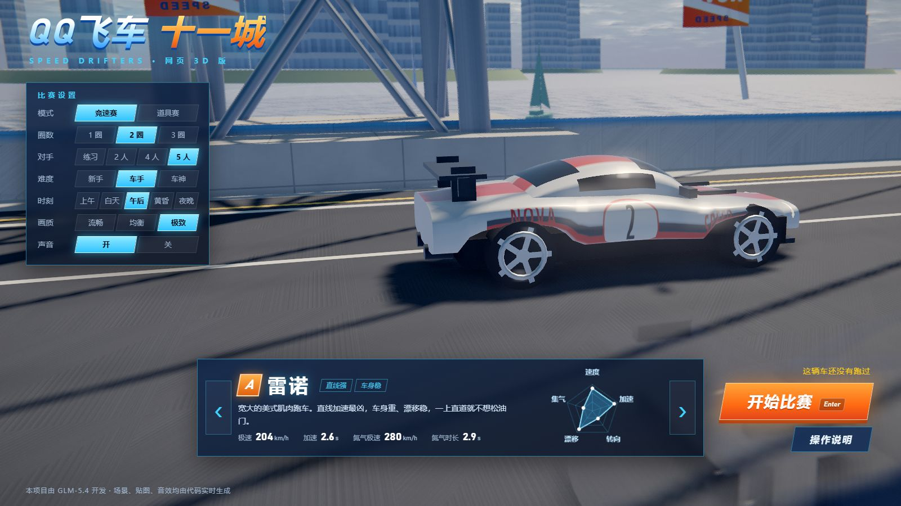

## 运行截图

都是正式页面（双击 `index.html`）的实际运行画面：`python tools/qa/gallery.py` 把比赛定位到对应状态后自动截取，没有后期修图。原图在 `docs/gallery/`。

| 开场镜头 | 漂移 |
| --- | --- |
| 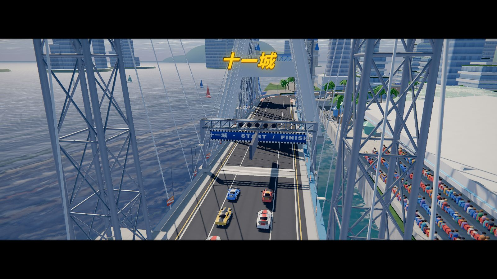 | 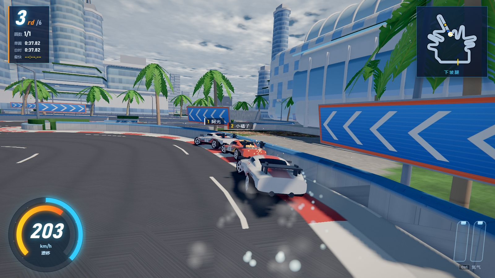 |
| **氮气** | **冲线** |
| 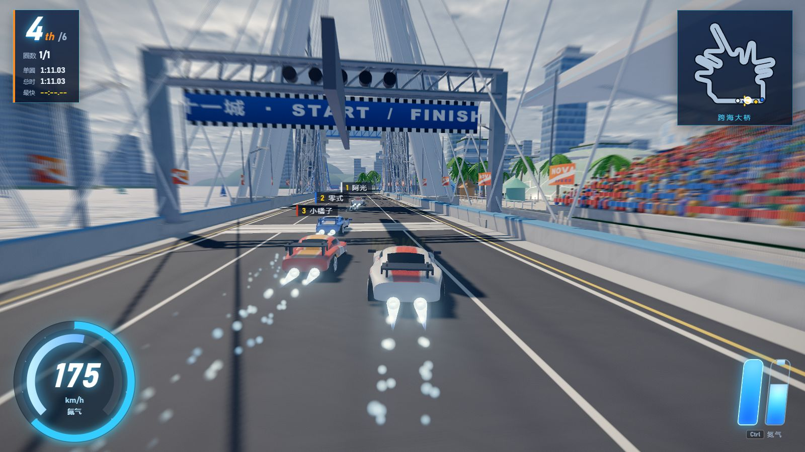 | 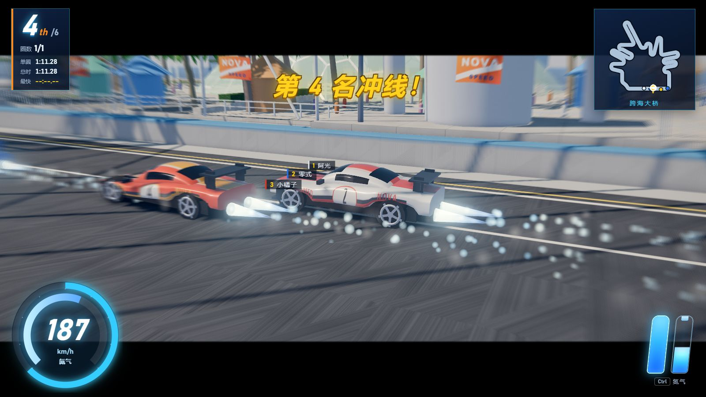 |
| **道具箱** | **天使护体** |
| 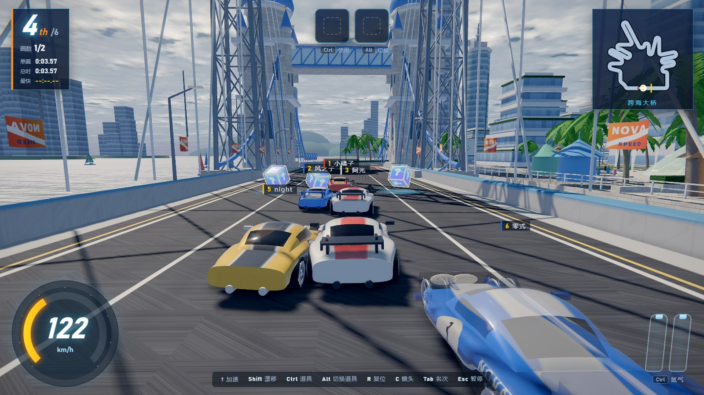 | 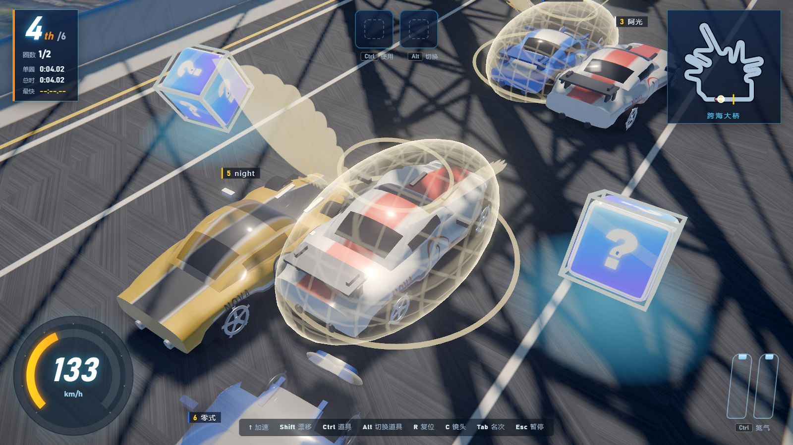 |
| **导弹** | **结算** |
| 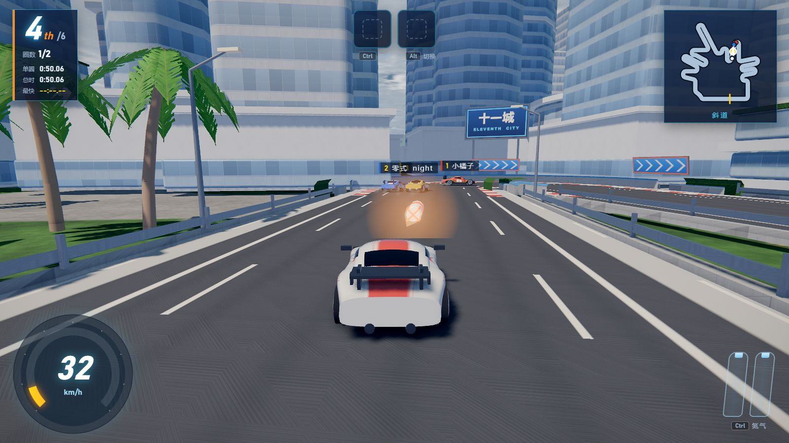 | 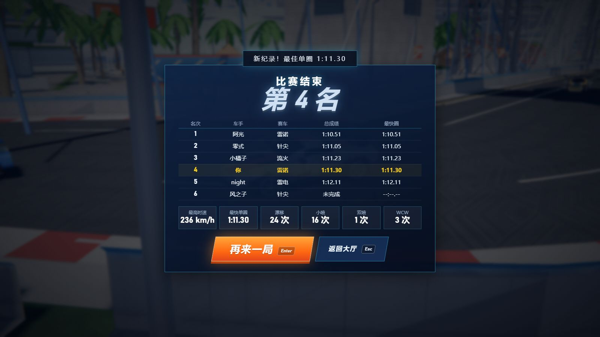 |

时刻可以选上午、白天、午后、黄昏、夜晚：

| 夜晚 | 夜晚 · 双喷 |
| --- | --- |
| 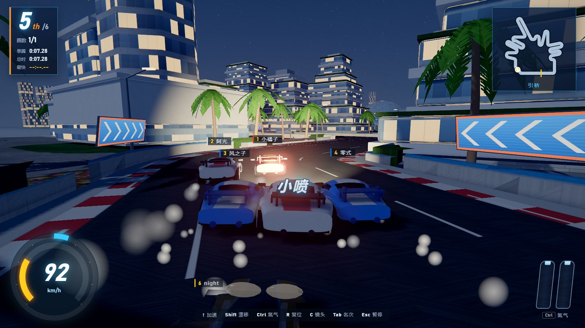 | 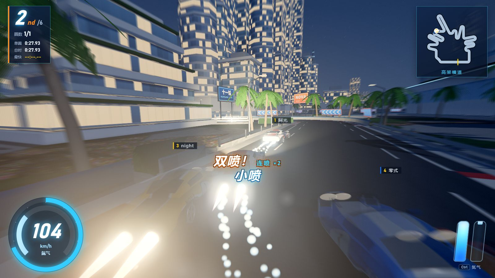 |

赛道沿途（自由镜头）：

| 跨海大桥 | 商城发卡弯 |
| --- | --- |
| 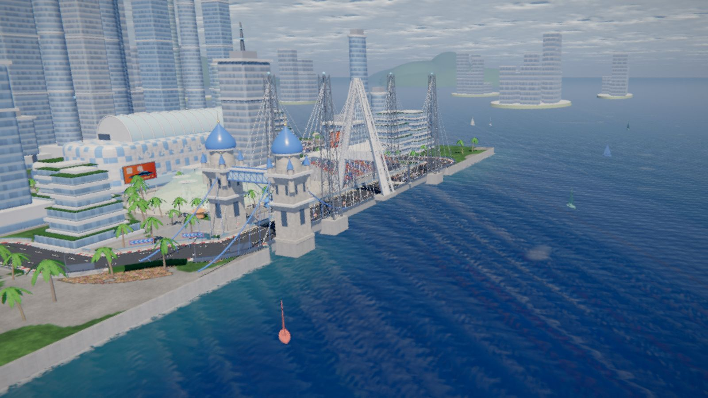 | 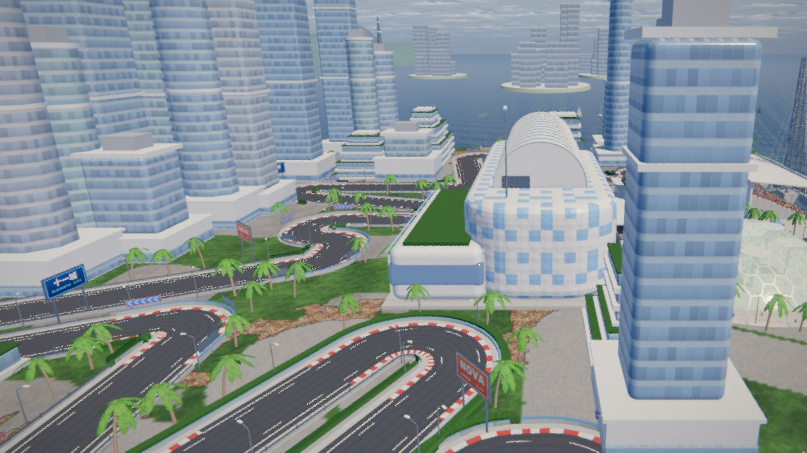 |
| **穹顶广场** | **斜拉桥塔** |
| 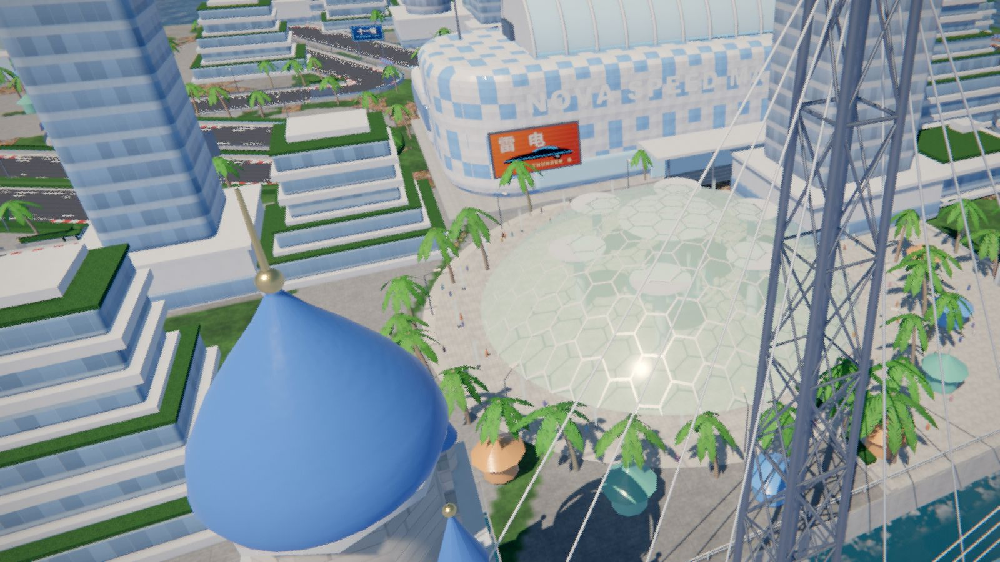 | 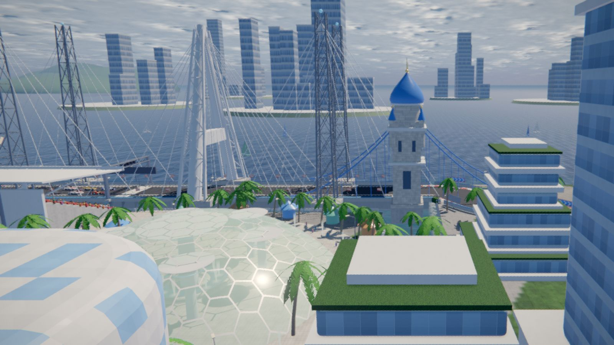 |
| **城市鸟瞰** | |
| 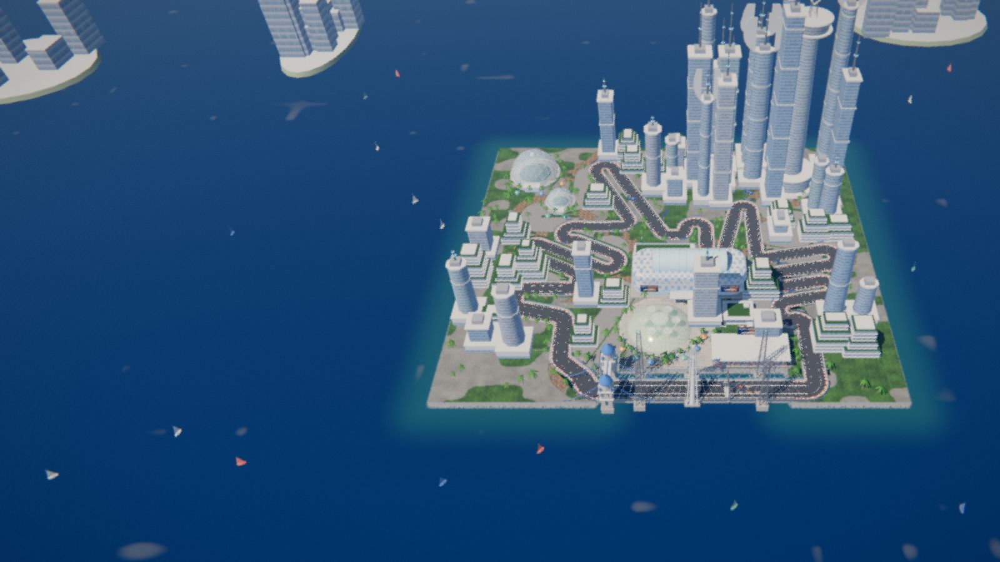 | |

## 打开方式

**直接双击 `index.html`** 就能打开（`file://` 下可用，不需要服务器，不需要联网）。

或者起一个本地服务器（改动源码后调试时更方便）：

```bash
npm run dev        # 零依赖静态服务器 → http://127.0.0.1:5273
```

浏览器要求：支持 WebGL2 的近期版本 Edge 或 Chrome（只在 Edge 上测过）。需要键盘，不支持触屏。

## 怎么玩

QQ飞车的经典键位原样保留，另外补了几个方便的键：

| 操作 | 作用 |
| --- | --- |
| `↑` / `W` | 加速 |
| `↓` / `S` | 刹车、倒车 |
| `←` `→` / `A` `D` | 转向 |
| `Shift`（按住） | 漂移 |
| `Ctrl` | 氮气（道具赛里是使用道具） |
| `Alt` | 切换手里的道具 |
| `R` | 回到赛道 |
| `Backspace` | 返回 |
| `PgUp` / `PgDn` | 上一首 / 下一首背景音乐 |
| `C` | 切换镜头：近景 / 远景 / 引擎盖 |
| `Tab`（按住） | 名次表 |
| `Esc` / `P` | 暂停 |
| `M` | 静音 |
| `Enter` | 确认 |

**大厅里能选**：模式（竞速赛 / 道具赛）、圈数（1–3）、对手（练习，或 2 / 4 / 5 个电脑车手）、难度（新手 / 车手 / 车神）、时刻（上午 / 白天 / 午后 / 黄昏 / 夜晚）、画质（流畅 / 均衡 / 极致）、声音。车库里有五辆车：新手赛车（D 级）、雷电（B 级）、雷诺、针尖、流火（A 级）。每辆车、每个圈数、每种模式的最快单圈分别记在浏览器里。

**漂移与喷射**：方向 + Shift 起漂，车头先转过去、速度方向晚一步跟上，两者之间的夹角就是漂移角。所有喷射技巧都由“按键沿 + 漂移状态”推出来，没有单独的按键。

| 技巧 | 操作 |
| --- | --- |
| 集气 | 漂移角越大、甩得越久，气越多；攒满一格得到一瓶氮气，最多带两瓶 |
| 小喷 | 漂移结束松开 Shift 后，马上再按一次 `↑` |
| 双喷 | 小喷还在喷的时候接氮气 |
| WCW | 氮气还在喷的时候完成一次漂移并小喷 |
| 断位双喷 | 直线上轻点方向 + Shift 起漂，马上松开，接小喷和氮气 |
| 甩尾漂移 | 先按住 Shift，再按方向键（车头甩得更猛） |
| 侧身漂移 | 漂移途中按反方向键（甩得宽、转得缓，适合救弯） |
| 完美起步 | 倒计时快结束时按下 `↑` |

**道具赛**：开过赛道上带问号的方块拿到道具，最多带两件。名次越靠前越容易拿到防守型的，越靠后越容易拿到进攻型的。道具赛里漂移只管过弯，没有小喷和集气，氮气只能从道具来。

| 道具 | 作用 |
| --- | --- |
| 导弹 | 锁定前一辆车追踪，命中把对方打转 |
| 水炸弹 | 往前扔，落点炸一片 |
| 香蕉皮 | 丢在身后，压到的车打滑 |
| 磁铁 | 吸向前车，加速追赶 |
| 天使 | 无敌 6 秒，挡下导弹、水炸弹和香蕉皮 |
| 氮气 | 立刻加速 |

**界面**：左上是名次、圈数和单圈 / 总时间，右上是小地图和所在的区段名，左下是速度表（外圈是集气条），右下是两瓶氮气（道具赛里是道具槽），车顶有车手名和名次。漂移、小喷、双喷、集气满、被导弹击中这些事都会在屏幕中间弹出来。

## 赛道还原了什么

布局是照着官方小地图做的：中心线在小地图（169 × 147 像素）上逐点标注，按 3 米 / 像素换算成世界坐标，再用官方截图核对自己的理解，单圈 1.75 公里。

- 每个顶点带倒角半径、该处的路宽和区段名。发卡弯是相距 2r 的两个顶点，两段 90° 圆弧首尾相接。
- 从底部的**跨海大桥**出发，向西：引桥 → 西岸大道 → 滨海横道 → 折角 → 长斜路（去程 / 回程）→ 回旋车道 → 顶部发卡 → 高架横道 → 上坡腿 / 下坡腿 → 联络道 → W 形发卡 → 回旋弯 → 斜道 → 北发卡 → 南廊 → 东发卡一 → 回程一 → 中发卡 → 东行二 → 东发卡二 → 回程二 → 钩形弯 → 末段，回到大桥。
- 地标照着原作摆在对应的位置：主岛中央的 NOVA 商城和它前面的绿色网格穹顶广场、西北角的展览馆测地线穹顶、跨海大桥上的 NOVA 拱门和斜拉桥塔、大桥西端的石塔桥、港湾北岸的看台、东北岸的环塔。

**这些是自创的，不是原版的**：城市楼群、地标的具体造型和细节、广告牌上的文字（“NOVA”“十一城”之外的牌子）、看台上的观众、赛车的模型和性能数值、电脑车手的名字、三首背景音乐。区段名是按赛道形状起的。原作的贴图、模型、音频一个都没有用，所以走近看建筑和车与原版并不一样。

## 它是怎么做的

- **赛道**：路面、桥面板、路缘、导向牌和五种护栏（护栏、防撞墙、桥栏、石栏、矮墙绿篱）都是把一条截面轮廓沿中心线扫出来的；贴图坐标按“沿截面走了多远 × 沿路走了多远”给，竖直的墙面上不会拉成条纹。陆地是两座岛，顶面是一张程序化画的城市地表图（人行道、广场、草坪、花坛按离赛道的距离自动分区）。
- **车辆物理**：街机式的漂移模型，不依赖 three。车是平面上的一个刚体，速度在车身坐标里拆成纵向和横向：抓地时横向很快被轮胎“咬住”，漂移时横向很滑，车头转得比速度方向快，尾巴就甩出去了。物理以 120 Hz 定步长推进，撞墙按前后两个碰撞圆各查一次。小喷、双喷、WCW、断位双喷、甩尾、侧身、集气都是从按键沿和漂移状态推出来的，可以在 Node 里不开浏览器跑整场比赛。
- **电脑车手**：走和玩家一样的物理。赛车线是在中心线基础上逐点调横向偏移、让整条线曲率平方和最小得到的，弯里自然走出“外—内—外”；再按曲率算一条速度曲线。开起来是纯跟踪 + 曲率前馈转向，按速度曲线收油刹车，弯太急就漂移，出弯点一下 `↑` 吃小喷再接氮气；道具赛里按名次决定用哪件道具。离玩家太远会慢一点或快一点。
- **道具赛**：道具的逻辑（`src/game/items.js`）只往事件列表里推“谁用了什么、谁被打中”，模型、粒子、声音、界面各自去响应，逻辑同样能在 Node 里测。
- **写实的渲染**：大气是物理模型——JS 积分出透射率查找表（球面地球，含地球阴影和臭氧，所以有曙暮光），GLSL 沿视线做内散射，烘焙成一张 HDR 等距柱状图，同时当天空、环境光照（PMREM）和海面的反射源用；太阳 / 月光颜色、雾色、天光强度都从同一套模型算出来，JS 和 GLSL 两套实现有单元测试比对。另画太阳盘、月亮、星星和程序积云。五个时刻各有一组关键帧；夜晚的曝光是白天的八倍，路灯、招牌、车灯、道具的亮度都按曝光换算过。
- **海**：铺到地平线的非均匀网格，五列方向波叠加；片元里是两层滚动的法线贴图、平面镜像相机画出的真实倒影、菲涅耳、粲光和贴岸的浪花，水色随离岸距离从浅绿松石变到深海蓝。
- **全程序化的贴图**：沥青、混凝土、石材、幕墙、草坪、木纹、车身涂装，都是逐像素烘出来的一套 PBR 贴图（颜色、法线、遮蔽·粗糙度·金属度），全部可平铺；招牌和文字在 Canvas 上排好再贴上去。颜色走顶点色，一套“漆面”能画出白的栏杆、蓝的饰带、红的路缘。
- **合批**：楼群、地标、护栏按材质静态合批，棕榈、路灯、广告牌、看台上的观众用实例化，整帧约 440 次绘制、131 万个三角形。开场前把所有着色器预热一遍，比赛中不会因为首次编译卡顿。
- **镜头**：开场从高处俯冲到车后；追尾镜头跟在“车头方向和速度方向的混合方向”的后上方，所以漂移时能看到车横着滑；纵向是刚性跟随，氮气时视野拉开，撞墙抖一下，贴墙时自动收杆；冲线后换环绕镜头慢放。挡在镜头和玩家之间的对手会变透明。
- **电影后期**：HDR 多重采样渲染 → 环境光遮蔽 → 泛光 → AgX 色调映射 → 速度感的径向拖影、色差、锐化、分离色调、镜头光晕、暗角、胶片颗粒；开场和冲线时加黑边。景深只在大厅和结算里开。进泛光之前先按位检查一遍像素：透明度算坏的 NaN 像素只坏自己那一块，不会被模糊抹成整屏黑。
- **声音**：全部用 WebAudio 现场合成。引擎是三层振荡器经软削波和低通，频率跟转速走；轮胎尖叫、风噪、氮气是不同滤法的噪声；倒计时、小喷、氮气、撞墙、集气满和每种道具都有音效；三首背景音乐由步进音序器循环。

## 目录

```
qq-speed/
├─ index.html、styles.css     页面和界面样式
├─ app.js                     打包产物（压缩版），页面只加载它
├─ src/
│  ├─ main.js                 入口：启动、状态切换、主循环、事件到特效 / 声音 / 界面的分发、调试接口
│  ├─ core/                   纯逻辑：赛道中心线、车辆物理、赛车数据、大气模型、时刻关键帧、音频合成基础（有单元测试）
│  ├─ world/                  陆地、城市、地标、赛道几何、小件、海、天空、贴图与材质
│  ├─ gfx/                    渲染舞台、后期、天空环境、平面反射、程序化贴图、静态合批
│  ├─ actors/                 赛车模型、道具的模型与特效
│  ├─ game/                   比赛、电脑车手、赛车线、道具、键盘输入、镜头
│  ├─ fx/                     粒子与胎痕
│  ├─ ui/                     大厅、HUD        audio/   声音
├─ tools/qa/                  自动化检查和截图脚本
├─ docs/gallery/              运行截图；docs/validation-report.md 验证报告；docs/evidence/ 检查日志
└─ licenses/three.js.txt
```

## 开发与验证

```bash
npm install                 # 只有重新打包时需要（three + esbuild）
npm run build               # 开发版 app.js（带 sourcemap）
npm run prod                # 压缩版 app.js
npm run dev                 # 本地服务器 http://127.0.0.1:5273

npm test                       # 单元测试 40 项 + 赛道自检（闭环、曲率、路宽、净距），不需要浏览器
node tools/qa/plan_check.mjs    # 地标占地自检：到路缘的净距、是否落在陆地或水面上、彼此是否重叠
node tools/qa/race_sim.mjs      # 不开浏览器跑整场比赛：每辆车的圈速、漂移和小喷次数、哪里撞墙
python tools/qa/run_all.py      # 一次跑完下面所有浏览器检查（约十二分钟），每项的日志存进 docs/evidence/
python tools/qa/game_check.py drive | ai | menu | item   # 真开一局：真实按键开车、电脑代跑进结算、大厅、道具赛混战
python tools/qa/pixel_check.py  # 读回 HDR 场景缓冲：不许有非有限的像素，材质数值必须是有限数
python tools/qa/perf.py         # 每个画质档、每种分辨率的单帧耗时
python tools/qa/audio_check.py  # 声音冒烟：第一次点击后音频启动，每个音效都能调用，三首曲子能切
python tools/qa/audit_geo.py    # 顶点色审计：用顶点色的材质必须有顶点色，否则画出来是黑的
python tools/qa/item_shot.py    # 每件道具的特写
python tools/qa/gallery.py      # 重新生成上面的运行截图
```

Python 脚本需要 Playwright 和系统里的 Edge（`pip install playwright pillow`）。脚本启动浏览器后会把它的进程钉在 CPU 的性能核上：测试用的机器是性能核 + 能效核混合的，Windows 有时会把无头的浏览器排到能效核，同一帧的耗时就慢一倍多，按真实时间写的按键脚本也会错位；平时玩的时候浏览器在前台，本来就跑在性能核上。调物理和电脑车手时还有 `drift_probe.mjs`（漂移特性）、`trace.mjs`（追踪单车）、`sweep.py`（扫参数）；画平面图有 `plan_map.py`。

页面暴露 `window.__game` 调试接口，URL 参数可以直接进入某个状态：`?autostart=1` 跳过大厅、`&skipintro=1` 跳过开场镜头、`&ai=1` 让电脑代开玩家的车、`&hour=22` 时刻、`&quality=0..2` 画质、`&freeze=1` 暂停模拟，`&orbit=x,y,z,距离,方位角,高度角,视野` 用自由镜头看场景。

## 验证结果与已知限制

在本机（RTX 3080，Windows 11，无头 Edge）上实际跑过的：

- 单元测试 40 项全部通过；按真实按键开车的一轮里，完美起步、漂移、小喷都触发成功；电脑代开跑完一场进了结算；道具赛 75 秒混战里六辆车用出 140 件道具，没有页面报错。
- 道具赛的黑帧：录像逐帧检查，六种道具各跑 20 秒，画面全黑的帧数是 0。读回 HDR 缓冲逐个特效检查，非有限的像素是 0。
- 单帧渲染耗时（含阴影、海水倒影、全部后期）：极致档 1600 × 900 下 5 毫秒上下、1920 × 1080 下 6 毫秒上下，白天和夜晚相近；均衡档 5 毫秒上下，流畅档 3 毫秒上下。同一个包多跑几轮会有正负 3 毫秒左右的浮动。大厅开着景深，极致档 5.5～8 毫秒。
- 启动到场景就绪约 4.4 秒，其中最后一段是显卡编译着色器——这一段放在加载界面后面，大厅一出来就是流畅的。

**没验证的**：只在 Edge + 这一张显卡上跑过（无头模式为主，另在真实窗口里打开确认过画面），Firefox、Safari、别的显卡都没测；**本地显示器上的帧率没有量过**——测试时这台机器是通过远程桌面连着的，远程显示器的刷新率是 32 Hz，浏览器里的帧率最高就是 32，所以拿得出手的只有单帧渲染耗时；声音没有听过，音色和响度没有经过耳朵；漂移的手感、难度是否合适这些只能人来判断。

**做不到的**：

- 模型全是代码拼的：赛车是放样出来的壳体，近看比商业游戏简单得多，座舱玻璃是不透明的、里面没有车手，引擎盖镜头也看不到内饰。
- 赛道的尺寸是按小地图换算的，和原版会有出入；弯道的细微形状、坡度（路面是平的）、建筑的细节都是近似的。
- 电脑车手是脚本 AI，会走赛车线、漂移、用道具，但不会配合战术。
- 只有和电脑比赛一种方式，没有联网、录像回放、改装、宠物这些系统；操作需要键盘。

细节、每项检查的输出和这次修掉的问题见 [docs/validation-report.md](docs/validation-report.md)。

## 开发过程与提示词

**本项目由 GLM-5.4 开发。** 模型在命令行编码代理里工作：自己读写文件、打包、跑测试、启动浏览器截图并逐张检查，再写验收脚本和这份文档。人只做两件事——提需求、看效果。仓库里这个目录的内容（第三方库 three.js 除外，见下面的版权与声明）都是 GLM-5.4 写的。

提示词只有这一句：

> 尽可能真实地还原 QQ 飞车中的游戏地图。我需要一个真实的 QQ 飞车游戏，包括游戏的各种键位以及漂移玩法，生成一个3d 页面，尽可能发挥你的所有能力。，使用3d写实场景，还有电影画质。

## 版权与声明

《QQ飞车》、「十一城」赛道及相关名称的权利归腾讯所有。这是一个非商业的同人练习作品，和权利方没有关系。

从原作借用的有：赛道名和它的布局（按官方小地图换算）、默认键位、漂移和喷射技巧的名字与规则、道具的种类和作用、几辆赛车的名字和分级。原作的图片、模型、音频、代码一样都没有用；赛车的模型和性能数值、城市、地标的样子、广告牌上的文字、电脑车手的名字和三首背景音乐都是自创的。开发时参考过的官方截图和小地图没有放进仓库。

[three.js](https://threejs.org/) 以 MIT 协议使用，版权声明见 `licenses/three.js.txt`。
