# 深海王城 · Sunken Castle

一座沉在四十米水下的石头王城：台地上一圈城墙和九座角塔，南门两旁立着拄三叉戟的守望者，城里有喷泉的前庭、带彩窗和金肋穹顶的王座厅；一条石桥跨过潟湖通向城门，四周是挤满珊瑚的花园、二十米高的巨藻林、半埋在沙里的大帆船、圆顶石屋的村落，再往外是断崖上的神庙和一尊三十多米高的巨像，望着深渊。

**写实的 3D 场景 + 电影画质**：阳光折射进水里、焦散、体积光束、彩窗投到地砖上的红黄光斑、按深度和距离衰减的水色、从水下往上看到的斯涅尔窗，加上环境光遮蔽、泛光和胶片调色。可以坐在镜头里看一场 16 个镜头、169 秒的电影巡游，也可以自己潜进水里，在城的里外随便游。

整座城、每一块礁石、每一棵珊瑚、所有贴图和所有声音都由代码在浏览器里**即时生成**：没有模型文件、没有图片素材、没有音频文件，页面运行时不联网。

**本项目由 GLM-5.4 开发**：场景、渲染、巡游、潜泳、声音、界面、测试和这份说明都是模型根据提示词写的，人只负责提需求和验收。提示词见文末的[「开发过程与提示词」](#开发过程与提示词)。

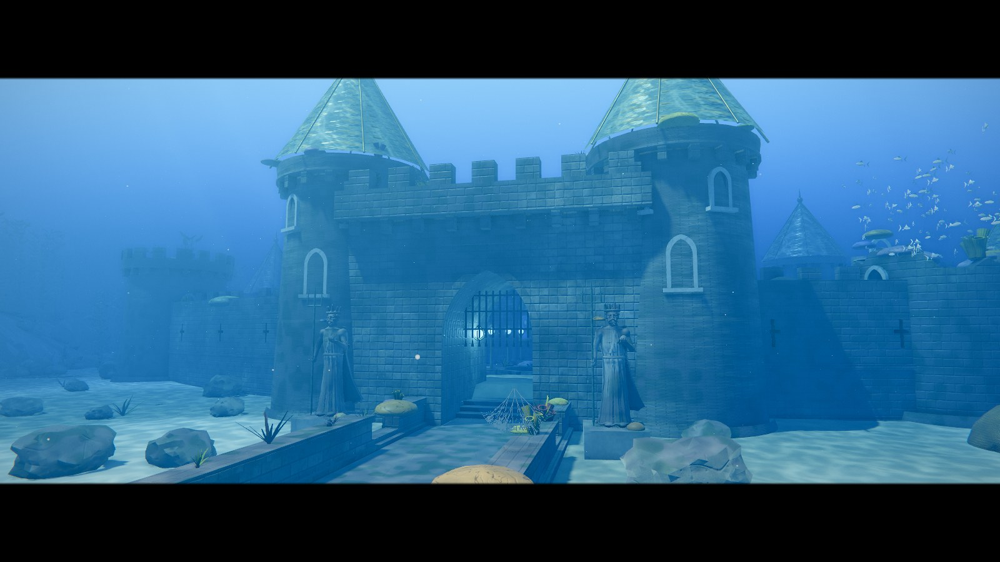

## 运行截图

都是正式页面（双击 `index.html`）的实际运行画面：`python tools/qa/gallery.py` 把巡游定位到对应的镜头、或把镜头摆到指定的机位以后自动截取，没有后期修图。原图在 `docs/gallery/`。

| **守望者** | **门洞** |
| 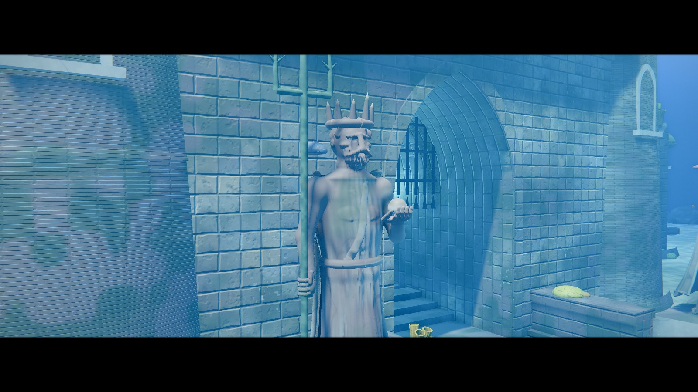 | 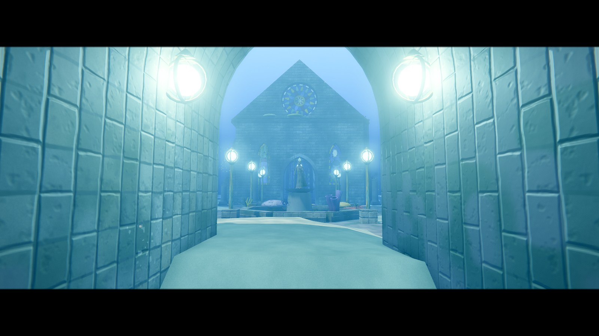 |
| **前庭（黄昏）** | **王座厅** |
| 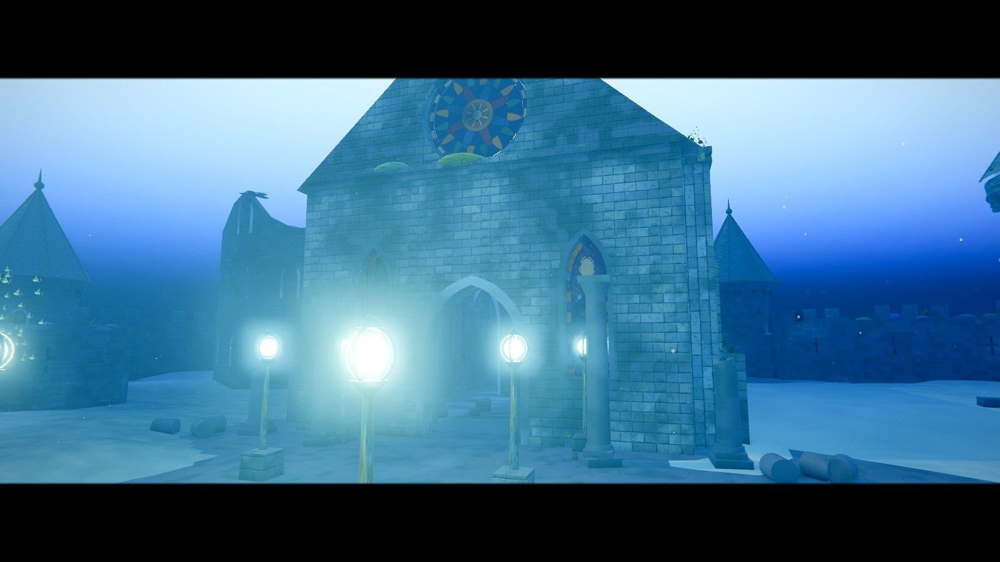 | 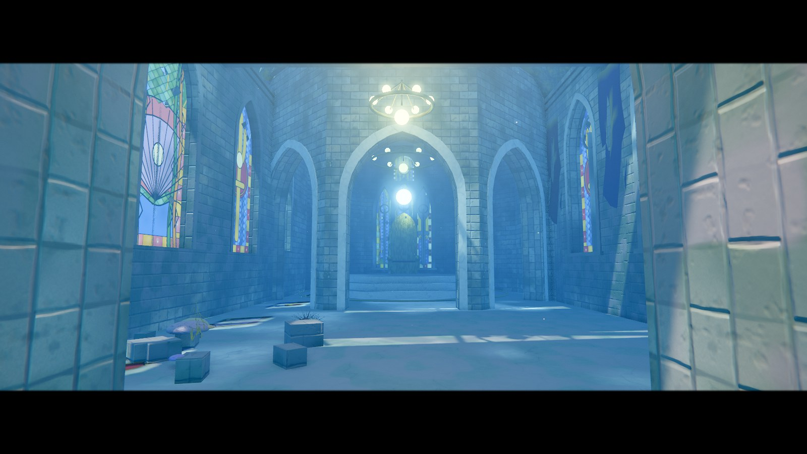 |
| **御座** | **穹顶** |
| 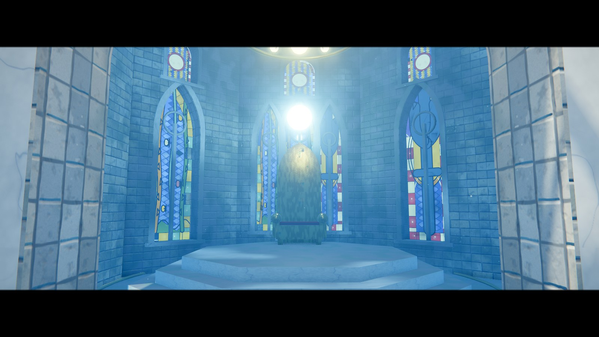 | 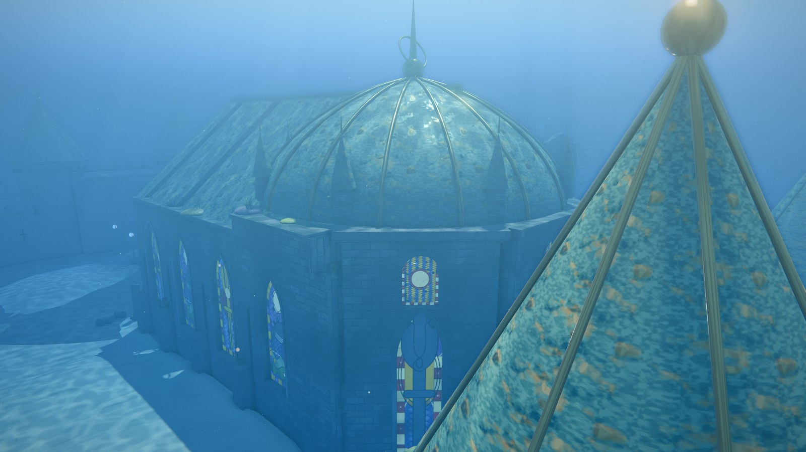 |
| **石拱** | **珊瑚花园** |
| 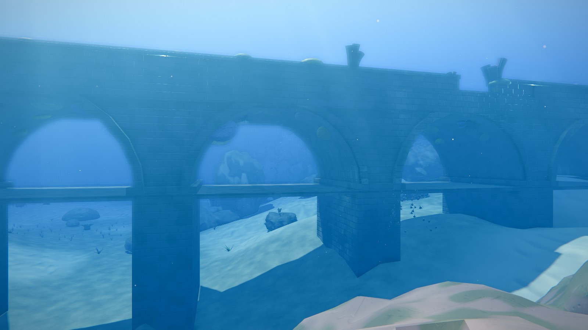 | 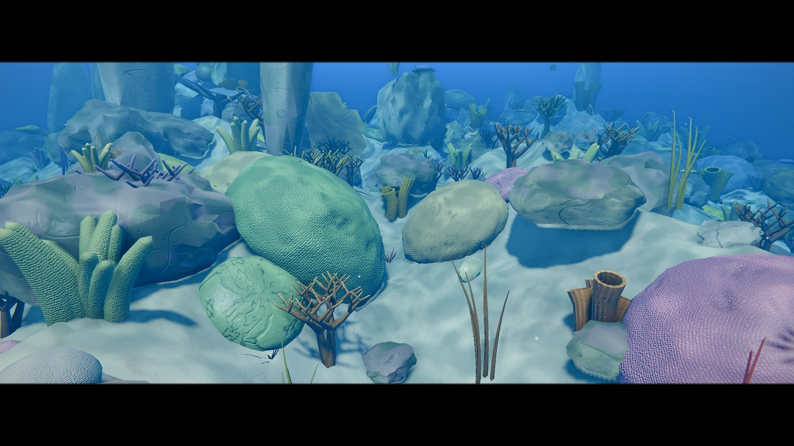 |
| **巨藻林** | **沉船** |
| 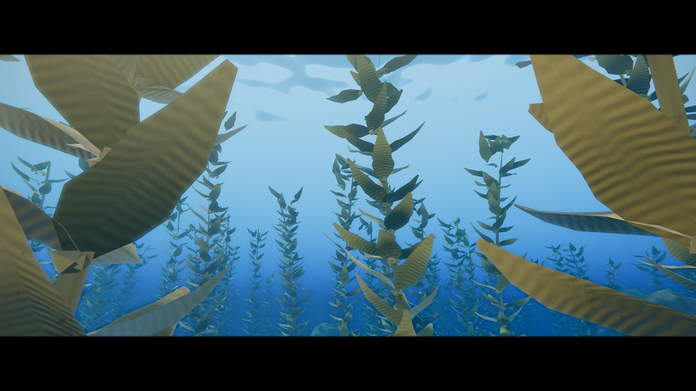 | 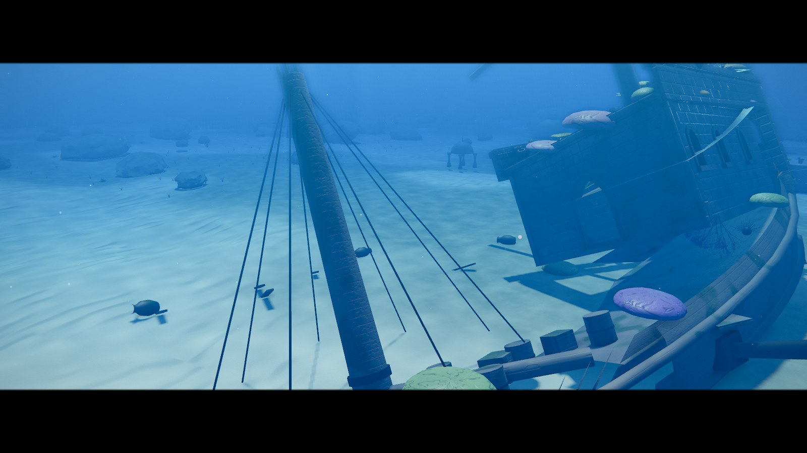 |
| **圆屋村落（黄昏）** | **断崖上的神庙** |
| 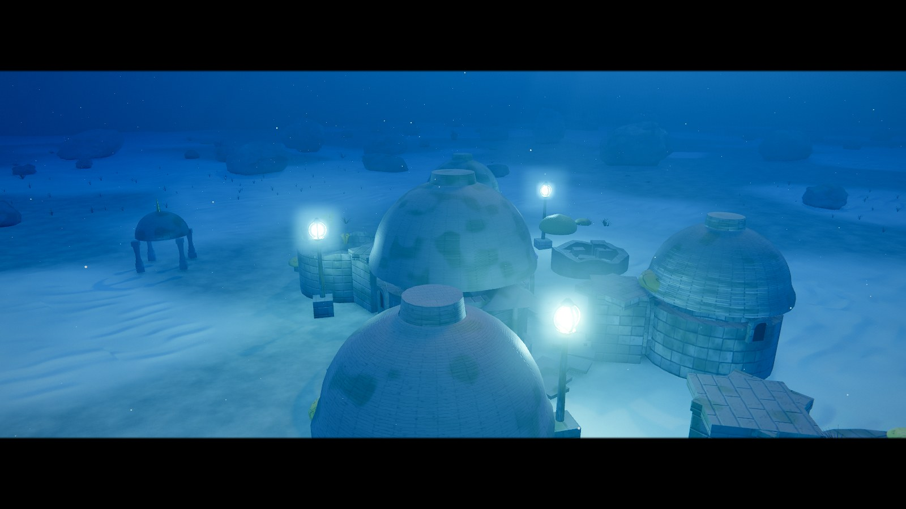 | 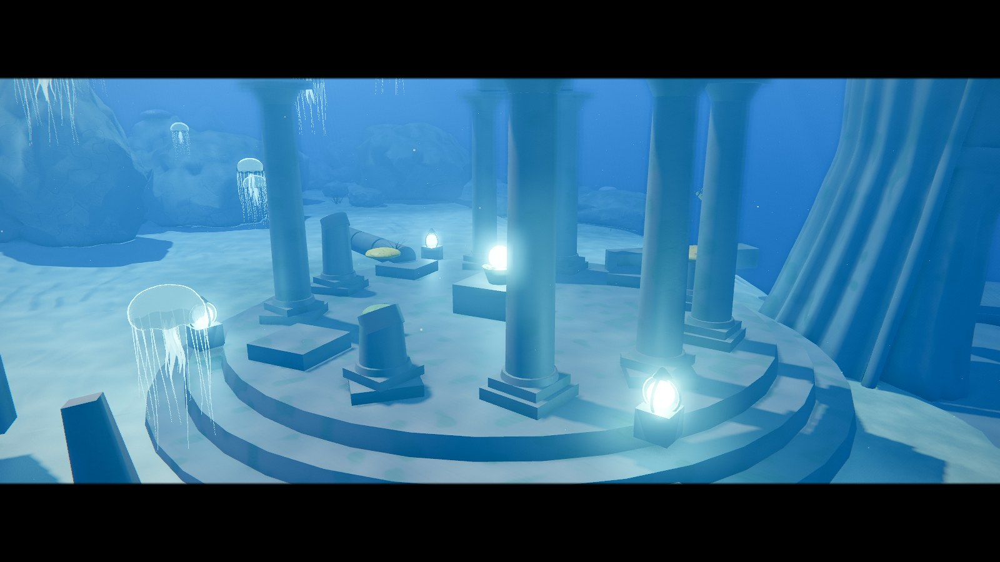 |
| **深渊巨像** | **夜晚的门洞** |
| 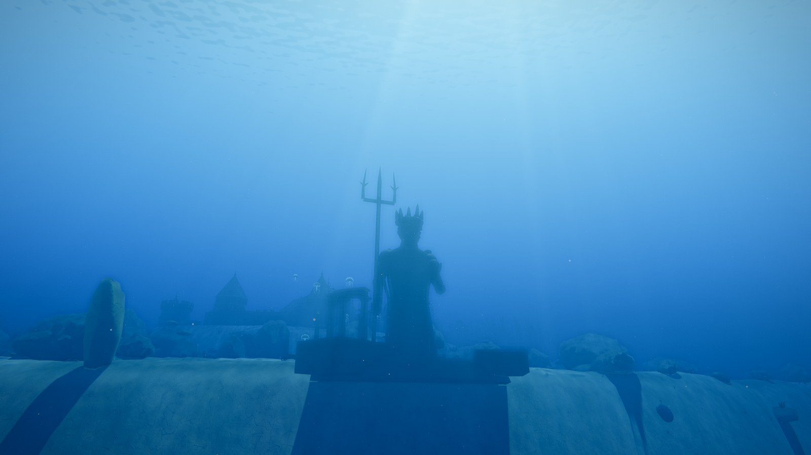 | 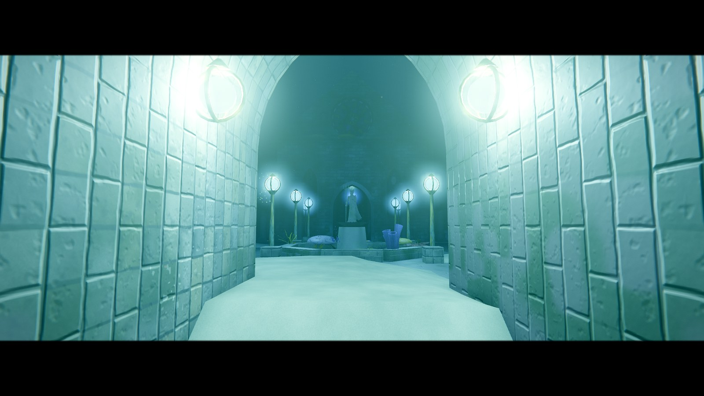 |
| **夜晚的王座厅** | **界面** |
| 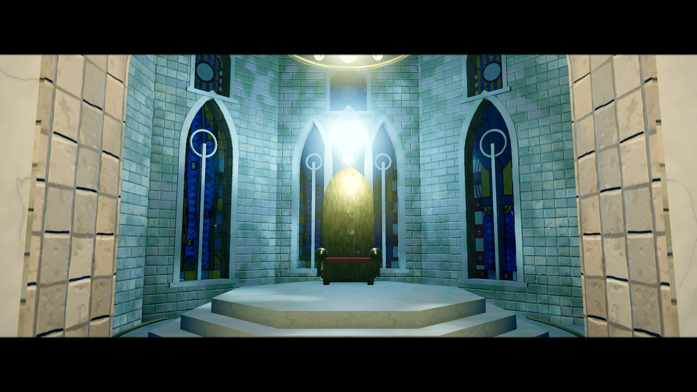 | 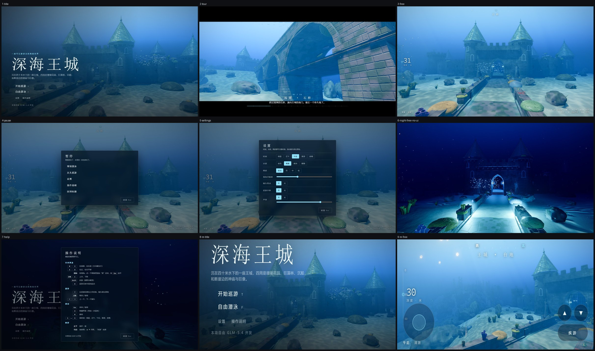 |

## 打开方式

**直接双击 `index.html`** 就能打开（`file://` 下可用，不需要服务器，不需要联网）。第一次打开要先把整座城搭出来、再把着色器都编好，加载画面上写着走到哪一步了。

或者起一个本地服务器（改动源码后调试时更方便）：

```bash
npm run serve        # 零依赖静态服务器 → http://127.0.0.1:5373
```

浏览器要求：支持 WebGL2 的近期版本 Edge 或 Chrome（只在 Edge 上测过）。键盘和鼠标最顺手，手机和平板的触屏也能玩。

## 怎么玩

页面有三种状态：**标题**（镜头在石桥南段的上空慢慢地来回，看着南门）、**电影巡游**（镜头沿着一条条路线穿过整座城，有字幕和进度）、**自由潜泳**（自己控制）。巡游和潜泳之间切换时镜头留在原地：从巡游切到潜泳，就是从当前画面接着往下游。

| 按键 | 作用 |
| --- | --- |
| `Enter` / `T`（标题上） | 开始巡游 |
| `F`（标题上） | 直接下水潜泳 |
| `Space`（巡游里） | 暂停 / 继续 |
| `→` / `←`（巡游里） | 下一个 / 上一个镜头 |
| `T`（巡游或潜泳里） | 巡游和潜泳互换 |
| 鼠标 | 转视角。点一下画面把鼠标“抓”进来，按 `Esc` 放开 |
| `W` `S`（或 `↑` `↓`） | 前进 / 后退 |
| `A` `D`（或 `←` `→`） | 左移 / 右移 |
| `Space`（潜泳里） | 上升 |
| `C` / `Z` | 下降 |
| `Shift`（按住） | 疾游 |
| `R` | 回到石桥 |
| `Esc` | 暂停菜单：继续、从头巡游、设置、操作说明、回到标题 |
| `H` | 隐藏 / 显示界面 |
| `1` … `5` | 换时刻：清晨、正午、午后、黄昏、夜晚 |
| `M` | 静音 |

触屏上，左下角是摇杆，右边拖动是转视角，右下角是上升、下降和疾游。

**巡游**顺着“进城”的路线走，一共 16 个镜头：潟湖的石桥 → 南门 → 守望者 → 门洞 → 前庭 → 王座厅 → 御座 → 穹顶 → 城墙 → 珊瑚花园 → 巨藻林 → 沉船 → 圆屋村落 → 断崖上的神庙 → 深渊巨像 → 回望王城。每个镜头有一条路线和一个注视点，带一点手持的呼吸感。

**潜泳**不能穿墙、不能钻进海床、不能浮出水面。游的时候隔几秒吐一口气泡，游得越快划水声越响。

**设置**里能选：

- 时刻：清晨、正午、午后、黄昏、夜晚。夜里灯笼的青光和荧光接管画面，声音也更安静、更沉。
- 水质：透亮、清澈、微浊、朦胧。越浑，远处的东西越快沉进蓝里，光束越明显。
- 画质：自动、流畅、均衡、极致。自动会看这台机器的帧间隔，撑不住就降一档，稳定一会儿再升回去。
- 视角灵敏度、镜头晃动、巡游字幕、声音和音量。

设置记在浏览器里，下次打开还是上次的。

地址栏的参数（给自动化和调试留的口子）：`?hour=night&clarity=hazy&q=1&mode=tour&shot=5`。`hour` 和 `clarity` 取上面这些名字，`q` 是 `auto`、`0`、`1`、`2`，`mode=tour` 加 `shot=第几个镜头` 直接进巡游的某个镜头，`mode=free` 直接下水，`ui=0` 不显示界面，`nolock` 不抓鼠标。页面还暴露了 `window.__game`：换时刻、换水质、换画质、跳镜头、量帧耗、读状态。

## 这个海底世界还原了什么

**光学是按物理关系写的**，常数按观感定：

- **阳光折射进水里**：斯涅耳定律，折射率 1.333。太阳最多离竖直 48.6°，方位不变。
- **衰减**：Beer–Lambert 律，每个通道各算各的。视线的消光系数（红、绿、蓝）是每米 0.094、0.036、0.020——60 米外蓝光还剩三成，红光基本没了。**这是有意偏保守的**：清澈的外海在四十米深处吸收得狠得多，那样整座城只剩单色蓝，材料的颜色全看不见。
- **水色**是散射进视线的天光的闭式解；**海面**从水下往上看是一个约 97° 的斯涅尔窗，窗外是全反射的镜面，按菲涅耳定律分配。
- **焦散**是波面把光聚散的结果，亮度取 1 / |雅可比行列式|。它和水面、光束用的是同一组波（17 列深水波，24 米一个周期，每一列满足 ω² = g·k），所以三者永远对得上。
- **天空**是大气散射的物理模型，JS 和 GLSL 各一套实现，用测试比对。

**形态**照着真实的样子做：巨藻（*Macrocystis*）一茎到底、螺旋着长出几十片窄叶、每片叶根一个小气囊；脑珊瑚表面一道一道的脊是几何；砗磲张开的两片壳和波浪形的外套膜；王座厅的两心拱、玫瑰窗、扶壁和哥特式侧堂的比例。**尺寸和数量是估的**。

**有意不像真的地方**：水比真实的清；月光比真实亮得多；灯笼的青色光和城、神庙、村落的模样都是创作，这座城是虚构的。

## 它是怎么做的

- **海底的光**（`src/gfx/waterlight.js`）挂在所有材质上：日光沿着折射后的太阳方向往下走，走到多深按 Beer–Lambert 律衰减多少，焦散回溯到水面上的入射点去取；天光按深度衰减；水体雾是逐通道的闭式解。每样东西都在同一片水里，远近、朝向、深度一致。
- **光束和焦散**：体积光从阴影贴图出发沿视线步进积分，颜色按纯水对红光的吸收上色——远处的光束是深蓝的，不是白雾。焦散按波面的雅可比行列式算亮度。
- **彩窗的光斑**：每扇带玻璃的窗登记一条记录，每帧把窗的轮廓沿日光方向投到地砖上，铺同一张图集的贴图，用“乘”混合——只有地砖上被太阳照到的像素才被染成玻璃的颜色。所以缺了玻璃的地方还是白光，铅条和窗花的影子还在。
- **王城**用一套“积木”（`arch.js`：墙、窗、柱、扶壁、穹顶、塔）搭出来，再按材质合成少量网格。石灰岩砌块、铺地、大理石、青铜、琉璃瓦、朽木的贴图都是逐像素烘出来的 PBR 贴图；彩窗是 Canvas 上画的六种花样（三叉戟、鲸、明珠、巨藻、太阳、拼花），分成菱形的小块、逐块上高光、画铅条、挖掉几块。
- **石像**是一个符号距离场：长袍、躯干、两条胳膊、十根手指、头、胡子、头发各是椭球或圆台，用平滑的并集融成一整块，眼窝是挖空的，衣褶和胸肌是贴在表面上的起伏；再用步进方格网格化成石头。腰带以下是 3 厘米的格子，上身和手是 1.5 厘米的格子，断口藏在腰带底下。门楼的守望者、喷泉上的小像、崖沿上的巨像共用这一份几何。
- **“沉了很久”**主要来自附着层（`growth.js`）：挂在石头一类的材质上，朝上的面、背光的角落按世界坐标的三维噪声长出藻膜和钙化藻的壳。
- **礁石**是八种“捏”出来的石头（细分之后沿半径按三个尺度的噪声推拉，再用几个断裂面切出块面），用实例铺满海床；珊瑚、海绵、海葵一共 14 种，按群落（礁丘、城墙头、石头顶、潟湖、巨藻林下、断崖）各有“谁占多少”的表；散布用的是带种子的抖动格子，每次打开都一样。
- **会动的东西**：鱼群是三种体形（细长、侧扁、长条）的模板加实例色，沿着闭合的路线游；两只海龟、一条蝠鲼、一条鲨鱼、三群水母、一头抹香鲸每个是一份手工几何，形变在顶点着色器里。海扇、海鞭、海草、巨藻、海葵随涌浪摆，相位取自这一棵在世界里的位置。
- **潜泳和碰撞**：人是一个半径 0.6 米的球，圆、墙段、方盒三种碰撞体从最近的一面把人挤出去。巡游的每条路线都用碰撞体检过净距。
- **电影后期**：HDR 多重采样 → 环境光遮蔽 → 光束 → 泛光 →（可选景深）→ AgX 色调映射 → 显示色域里的最后一道：色差、轻锐化、分离色调、饱和度、对比、暗角、胶片颗粒、电影黑边。眼睛适应负责时刻 × 深度的曝光。
- **声音**全部用 WebAudio 现场合成：三层水声的底子、跟着泳速走的划水声、隔一阵响一声的鲸、沉船附近的木头和铁的呻吟、气泡、一层很轻的和声铺底。夜里更安静、更沉。
- **启动**：加载画面里把场景里所有材质的着色器程序先编好（并行的扩展），再一个材质一个材质各画一遍，最后不裁剪地整体画一帧——不然每样东西第一次进视野都要现编译、现传几何，画面会卡两三秒。

## 目录

```
sunken-castle/
├─ index.html、styles.css     页面和界面样式
├─ app.js                     打包产物，页面只加载它
├─ src/
│  ├─ main.js                 入口
│  ├─ core/                   纯计算：海床和分区、水下的光学、天空模型、波、散布、数学、音频合成基础（有单元测试）
│  ├─ world/                  王城、石桥、石像、沉船、村落和遗迹、礁石、珊瑚、巨藻、海草；建筑和珊瑚的贴图；合起来搭成世界
│  ├─ gfx/                    渲染舞台、水下的光照、海面、光束、倒影、后期、天空环境、附着层、程序化贴图、合批
│  ├─ actors/                 鱼群、大动物、灯笼、彩窗的光斑、海洋雪和气泡、游泳的人
│  ├─ game/                   巡游的分镜和镜头、潜泳、碰撞
│  ├─ audio/                  声音
│  └─ ui/                     标题、暂停菜单、设置、罗盘和字幕、触屏控件
├─ tools/qa/                  自动化检查和截图脚本
├─ tests/                     单元测试，不需要浏览器
├─ docs/gallery/              运行截图；docs/validation-report.md 验证报告；docs/design-system.md 设计上的决定；docs/evidence/ 检查日志
└─ licenses/three.js.txt
```

## 开发与验证

```bash
npm install                 # 只有重新打包时需要（three + esbuild）
npm run build               # 开发版 app.js（带 sourcemap）
npm run prod                # 压缩版 app.js
npm run serve               # 本地服务器 http://127.0.0.1:5373

npm test                       # 单元测试，不需要浏览器
python tools/qa/run_all.py     # 一次跑完下面所有浏览器检查（约十一分钟），每项的日志存进 docs/evidence/
python tools/qa/app_check.py   # 启动日志、真实按键点一遍：巡游、潜泳、设置、暂停菜单、触屏控件
python tools/qa/pixel_check.py # 读回 HDR 场景缓冲：不许有非有限的像素，镜头该动的时候画面该变
python tools/qa/audio_check.py # 声音的电平：底噪、鲸、船的呻吟、静音、夜里
python tools/qa/audit_geo.py   # 场景审计：顶点色和材质配不配得上、有没有坏数，数一数网格和三角形
python tools/qa/perf.py        # 每个画质档、每种分辨率的单帧耗时
python tools/qa/real_window.py  # 在弹出来的真实窗口里打开一次：按回车巡游、下水游两秒，截图后自己关掉
python tools/qa/gallery.py     # 重新生成上面的运行截图
```

Python 脚本需要 Playwright、Pillow 和系统里的 Edge（`pip install playwright pillow`）。脚本启动浏览器后会把它的进程钉在 CPU 的性能核上：测试用的机器是性能核 + 能效核混合的，Windows 有时会把无头的浏览器排到能效核，同一帧的耗时就慢一倍多。

## 验证结果与已知限制

在本机（RTX 3080，Windows 11，无头 Edge）上实际跑过的：

- 单元测试 54 项全部通过；用真实的键盘和鼠标把页面点一遍，46 项断言全部通过，控制台干净。
- 画面：读回 HDR 缓冲扫了 43 帧（标题上 5 个时刻 × 4 种水质、巡游的 16 个镜头、王座厅的 5 个时刻、手机上两帧），非有限的像素是 0。
- 声音：每个音效和底子的电平都量了，没有削波，静音是真的没声。
- 场景审计：1366 个网格、1036 万个三角形，顶点色和材质都配得上，没有坏数。
- 单帧渲染耗时（含阴影、倒影、全部后期）：1920 × 1080 下极致档 7.7 ～ 10.7 毫秒、均衡档 7.2 ～ 9.8 毫秒、流畅档 4.3 ～ 5.0 毫秒；1280 × 720 下极致档 6.6 ～ 8.7 毫秒、流畅档 3.3 ～ 4.4 毫秒。都在 60 帧的预算（16.7 毫秒）以内。
- 启动到场景就绪：浏览器起来以后第一次打开约 5.3 秒，第二次约 3.7 秒。最后一段是让显卡把着色器都编好、每样东西先画一遍，放在加载画面后面，巡游一开始就是流畅的。
- 另外在弹出来的真实窗口里打开过一次（系统 Edge，1600 × 900）：按回车开始巡游、按 `T` 下水游了两秒，控制台干净，自动画质停在极致档。

**没验证的**：只在 Edge + 这一张显卡上跑过（以无头模式为主），Firefox、Safari、别的显卡都没测；**本地显示器上的帧率没有量过**——测试时这台机器是通过远程桌面连着用的，拿得出手的只有单帧渲染耗时；声音没有听过，音色和响度没有经过耳朵；巡游的节奏、潜泳的手感、画面的好坏这些只能人来判断；手机上只用模拟的触屏事件点过，没有在真机上跑。

**做不到的**：

- 模型全是代码生成的。石像、王座厅、沉船这些主角近看是认得出来、经得住两三米的距离的；再贴近就能看出面数和格子（石像的脸和手是 1.5 厘米的格子，袍子是 3 厘米的），小动物的形体也简单。
- 水里的能见度、月光的亮度是按好看调的，不是按真实的洋流和水质。
- 没有任务、收集、战斗，只有看和游；碰撞体是简化的几何，披风的下摆和极细的枝条挡不住人。

细节、每项检查的输出和这次修掉的问题见 [docs/validation-report.md](docs/validation-report.md)，设计上的决定见 [docs/design-system.md](docs/design-system.md)。

## 开发过程与提示词

**本项目由 GLM-5.4 开发。** 模型在命令行编码代理里工作：自己读写文件、打包、跑测试、启动浏览器截图并逐张检查，再写验收脚本和这份文档。人只做两件事——提需求、看效果。仓库里这个目录的内容（第三方库 three.js 除外，见下面的版权与声明）都是 GLM-5.4 写的。

提示词只有这一句：

> 尽可能真实的还原海底真实世界，我需要一个真实的海底城堡世界，需要各种海底风景和建筑，生成一个3d页面，尽可能发挥你的所有能力， 使用3d写实场景，和电影画质。

## 版权与声明

这是一件原创的作品，城、神庙、村落、石像的样子都是虚构的。

[three.js](https://threejs.org/) 以 MIT 协议使用，版权声明见 `licenses/three.js.txt`。
