# 秋千跳跳 · Swing Hop

云海上一排浮空的小岛，每座岛上一棵树，树枝探出岛沿吊着一个秋千。一只系红围巾的白兔按住蓄力、松手，从一个秋千跳到下一个：落在正中有连击加分，一路还有金色秋千、宽板凳和会断的旧秋千。荡过两个秋千以后，一只踩着风暴云的狼从身后追上来——被追上，这一局就结束。

**2.5D**：玩法是横版的，像“跳一跳”那样按一下、跳一下，只有左右和上下；画面是真正的三维场景——镜头从侧面偏左、略高处看着，岛后面有积云，远处有雾里的小岛和云堤，镜头跟前有飘过的云。镜头跟着兔子走的时候，这几层的快慢不一样，纵深就从这儿来。

整个场景、兔子、狼、所有贴图和所有声音都由代码在浏览器里**即时生成**：没有模型文件、没有图片素材、没有音频文件，页面运行时不联网。

**本项目由 GLM-5.4 开发**：场景、渲染、玩法、声音、界面、测试和这份说明都是模型根据提示词写的，人只负责提需求和验收。提示词见文末的[「开发过程与提示词」](#开发过程与提示词)。

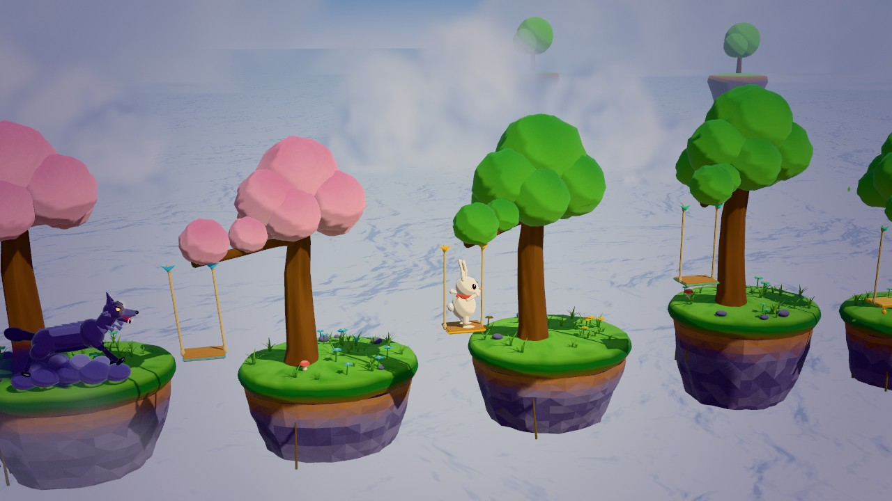

## 运行截图

都是正式页面（双击 `index.html`）的实际运行画面：`python tools/qa/gallery.py` 真的玩到那一步，在最合适的一瞬把规则停住以后自动截取，没有后期修图。原图在 `docs/gallery/`。

| **标题** | **开局** |
| --- | --- |
| 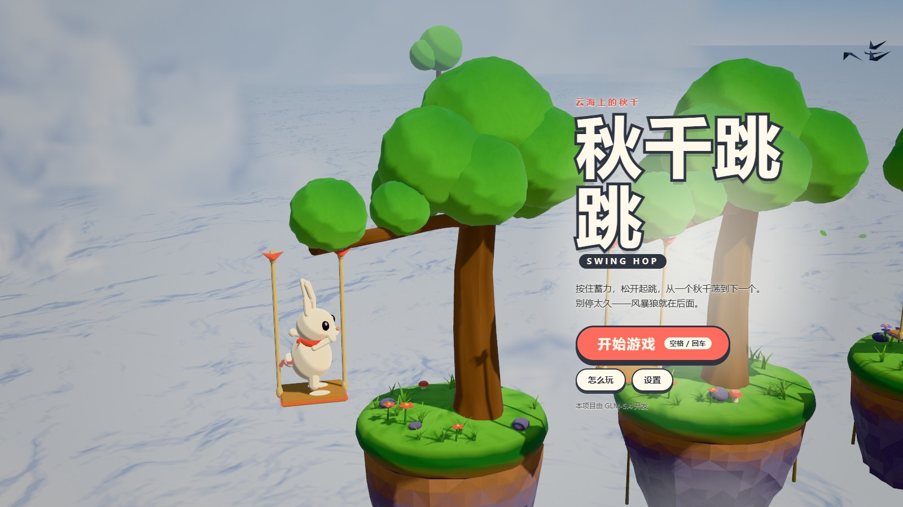 |  |
| **蓄力** | **起跳** |
| 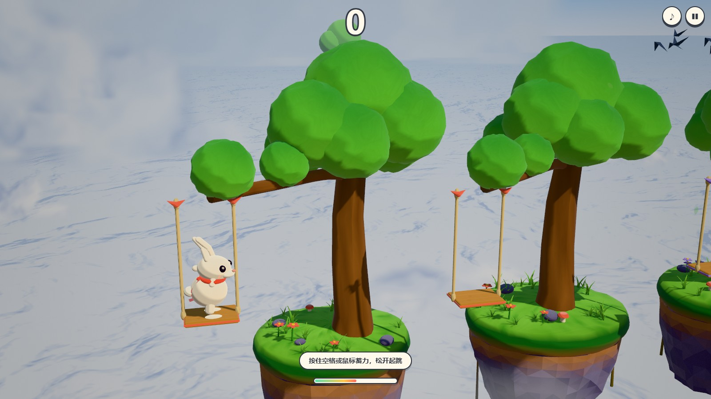 | 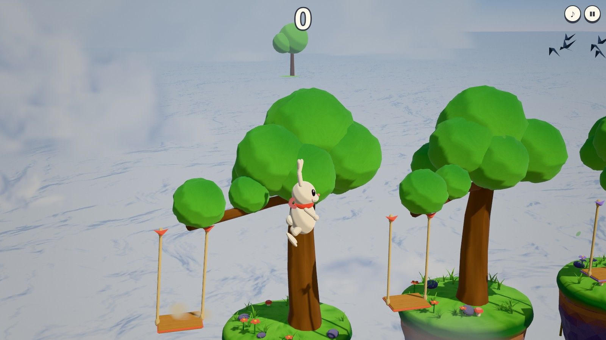 |
| **落在正中** | **金色秋千** |
| 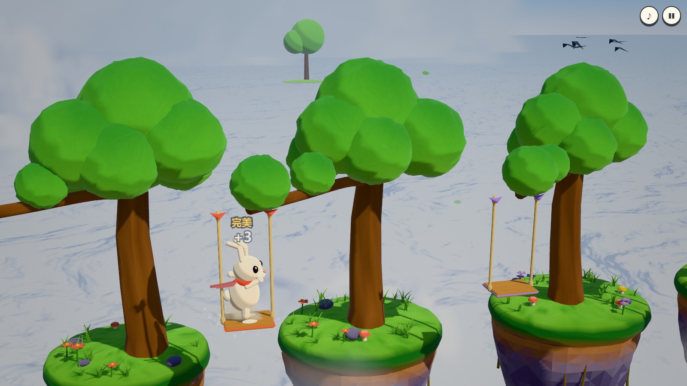 | 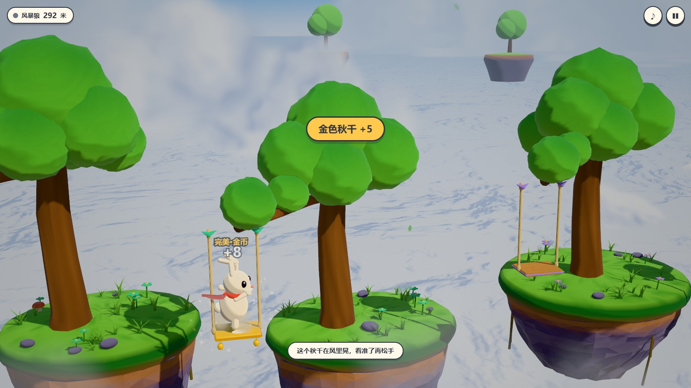 |
| **风暴狼追近** | **被扑倒** |
| 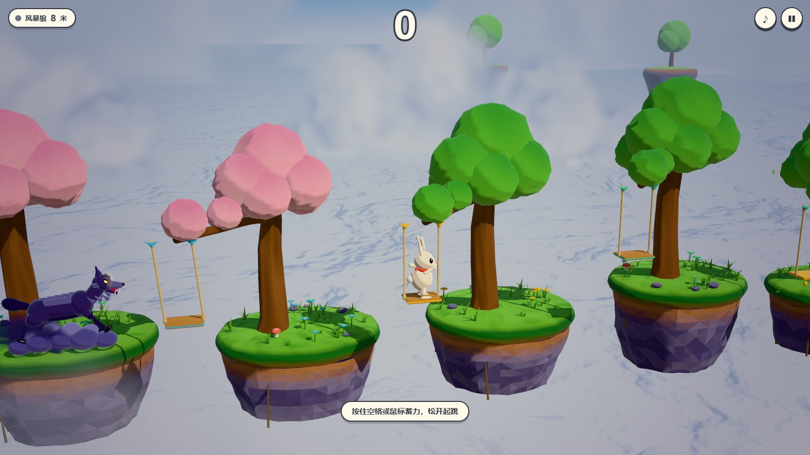 | 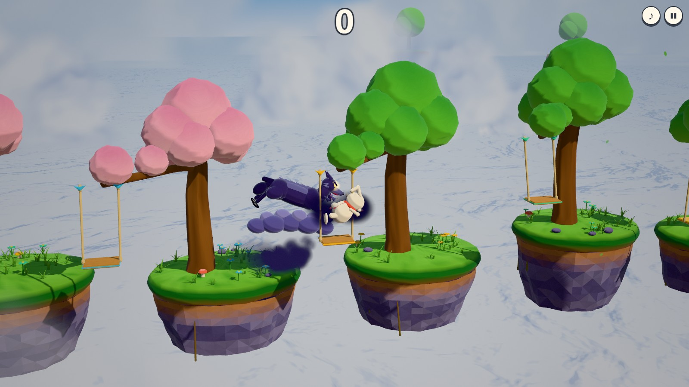 |
| **裂缝的旧秋千** | **秋千断了** |
| 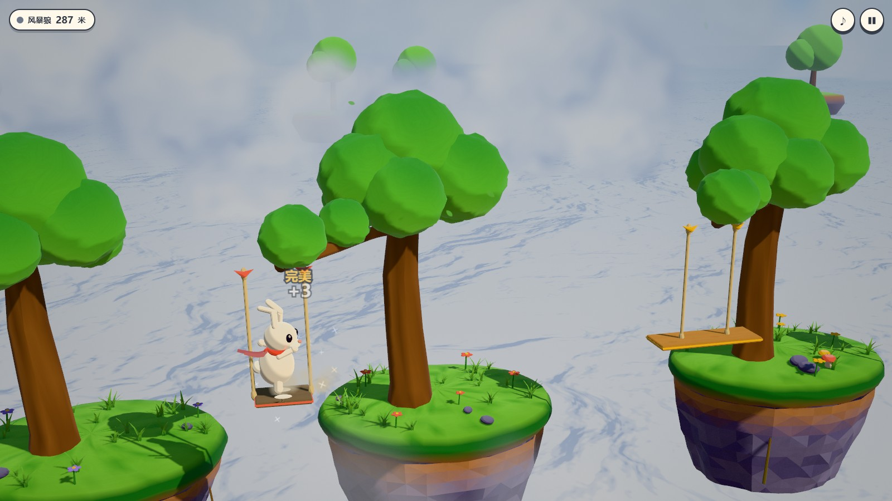 | 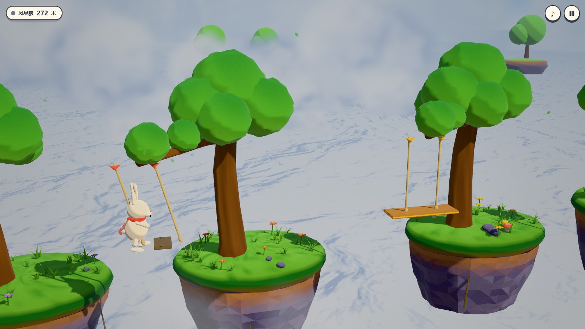 |
| **结算** | **手机横屏** |
| 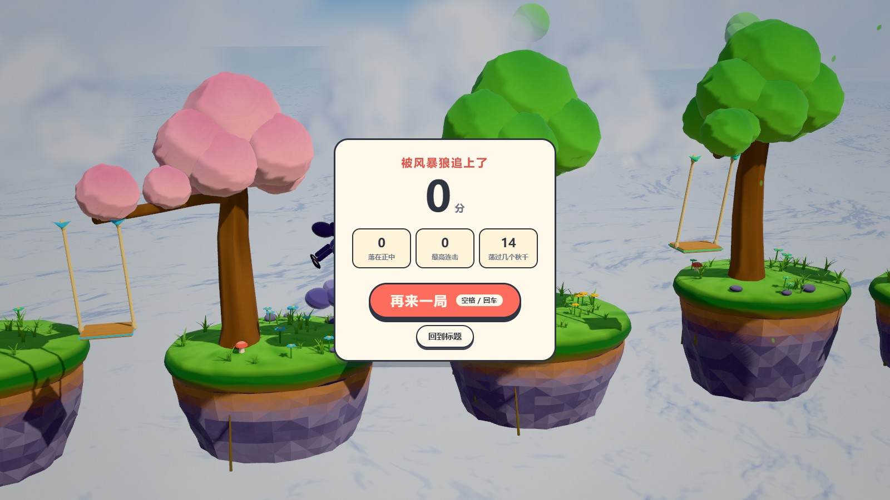 | 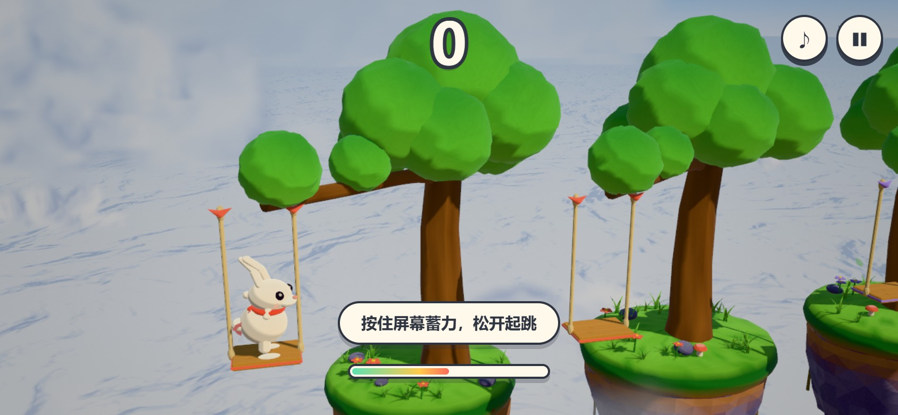 |
| **界面** | |
| 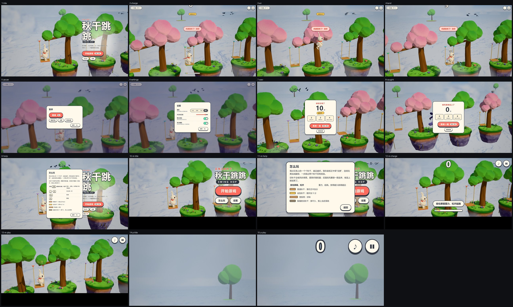 | |

## 打开方式

**直接双击 `index.html`** 就能打开（`file://` 下可用，不需要服务器，不需要联网）。第一次打开要先把头几座岛搭出来、再把着色器编好，加载画面上写着走到哪一步了。

或者起一个本地服务器（改动源码后调试时更方便）：

```bash
npm run serve        # 零依赖静态服务器 → http://127.0.0.1:5374
```

浏览器要求：支持 WebGL2 的近期版本 Edge 或 Chrome（只在 Edge 上测过）。键盘和鼠标最顺手，手机和平板的触屏也能玩。

## 怎么玩

按住（鼠标左键、`空格`、`↑` 或 `W`）开始蓄力，松手起跳；按得越久跳得越远。落在下一个秋千的座板上就往前走一步，掉进云海这局就结束。

| 按键 | 作用 |
| --- | --- |
| 鼠标左键 / `空格` / `↑` / `W`（按住） | 蓄力，松开起跳 |
| `空格` / `回车`（标题上） | 开始 |
| `空格` / `回车` / `R`（结算上） | 再来一局 |
| `Esc` | 暂停：继续、重新开始、设置、回到标题 |
| `M` | 静音 |

手机上，手指按住屏幕蓄力，松开起跳。

**计分**：落上去 +1；越过中间一个秋千直接落到下下个 +3。落在座板正中（离中心不到 14 厘米）是“完美”，额外加 2 分，连着落在正中每连一次翻一倍，最多加 32；踩在板边上站不稳，会滑下去。

**秋千有四种**：普通的；**金色**的落上去 +5，前沿挂着两个小铃铛；**宽板凳**长一倍，好踩；**裂缝的旧秋千**站上去 2.6 秒就断，落上去就得赶紧走。从第六个起，有些空秋千会被风吹得左右晃，越往后晃得越开，要看准了再松手。

**风暴狼**：荡过两个秋千以后，它从身后 30 米处追上来，越往后跑得越快。左上角一直写着狼还有多少米，8 米以内发红、发抖，画面也往左放宽把它框进来，四角发紫。被追上这局就结束，卡片上写着“被风暴狼追上了”。

**设置**里能选：

- 画质：自动、流畅、均衡、极致。自动会看这台机器的帧间隔，撑不住就降一档，稳定一会儿再升回去。
- 落点辅助：按住的时候画出这一跳的弧线。
- 镜头晃动、声音、音量。

设置和最高分记在浏览器里，下次打开还是上次的。

地址栏的参数（给自动化和调试留的口子）：`?seed=5&q=2`。`seed` 是这一局的种子，`q` 是 `auto`、`0`、`1`、`2`。页面还暴露了 `window.__game`：读状态、读绘制统计、跳到第几个秋千、把狼摆到多远、把规则停住、量帧耗、把场景画进 HDR 缓冲读回来数坏像素。

## 设计了什么

规则全在 `src/core/` 里，不依赖 three.js，可以脱开浏览器成千局地模拟。里面有一个会玩游戏的机器人（`src/core/bot.js`），它每次落地以后先“犹豫”一段时间再起跳，用来模拟不同手速的玩家。每种手速 200 局的结果：

| 每跳犹豫多久 | 中位数荡了多少个秋千 | 怎么结束的 |
| --- | --- | --- |
| 不到 0.5 秒 | 400（模拟的上限） | 都没死 |
| 0.6 ～ 1.4 秒 | 166 | 全部被狼追上 |
| 1.0 ～ 2.0 秒 | 42 | 四分之三被追上，四分之一秋千断了 |
| 1.5 ～ 3.0 秒 | 22 | 一半秋千断了，一半被追上 |

所以这个游戏没有终点，玩的是节奏：手快就一路荡下去，一犹豫狼就逼近；越往后旧秋千越多，站上去等着也不行。前四个秋千的间隔是固定的（4.6 ～ 5.2 米），之后慢慢变宽到 8 米；高度每一步上下最多差 0.55 米，整体不会一路漂走。这些数字怎么定的、为什么这样定，见 [docs/design-system.md](docs/design-system.md)。

## 它是怎么做的

- **规则和画面分开**：`src/core/` 里只有数字，画面只读状态。规则以 1/120 秒为上限一步一步推进；按下和松开的事件带着它发生的时刻，推进到那个时刻再处理——所以按住多久就是多久，和帧的长短无关。
- **跳跃**：重力取真实值的两倍多（22 米/秒²），起跳角 46°，按 1.1 秒按满，最远跳 11 米左右；秋千自己的摆动反而按真实的重力算，晃起来的节奏才像真的。
- **卡通材质**（`src/gfx/toon.js`）改自 three.js 的 `MeshToonMaterial`：明暗分三段，加半球的补光、轮廓边一圈淡冷色、按世界坐标的颗粒；风把顶点往一边偏，偏多少存在每个顶点里。场景里除了云、天空和粒子，全是这一种材质——画风统一靠的是这个。
- **岛和树**拼成一个网格（带顶点色），分六步建、每帧只建一步，玩到哪儿建到哪儿，走出镜头的拆掉放干净。草地和草皮是圆滑的，岩石是一块块的平面。
- **秋千**按真的做：树枝上隔着 0.86 米的两点各系一根绳，两根绳始终平行，木板永远水平；踩偏了会倾，落地时绳子被拽长一下再弹回来。
- **兔子**和**狼**都是球和胶囊拼的，动作全是代码摆的：压扁拉长、带惯性的耳朵、布料模拟的围巾飘带、空翻；狼踩在一朵同种材质的风暴云上追，追上时扑过来。
- **2.5D 的纵深**：玩法固定在 `z = 0` 这个平面上；远景按纵深分成几层——天空穹顶、很远的云堤、远处的小岛、岛后面的积云、云面上的鼓包、镜头跟前的前景云，都是真的三维位置，所以镜头往右走的时候各层快慢不一样。
- **云**：云海是一大块平面，着色器里用噪声堆出起伏、按法线算三段明暗；积云是一片片正对镜头的软片子，在自己的着色器里贴着云海面的高度淡出。
- **后期**只有两道：HDR 多重采样的场景缓冲 →（暗角、危险时的紫边、白闪、很轻的颗粒）→ 色调映射。没有泛光——这种画风靠的是干净的色块，要发光的地方自己带一片叠加的柔光。
- **镜头**是三个弹簧，追着兔子；画面多宽由规则那边算（兔子和下一个秋千都在框里，狼追近了把它也框进来）。
- **声音**全部用 WebAudio 现场合成：风声和一层很轻的和声做底子，蓄力时越按越高的气声，起跳、落地的木头声、落在正中往上升的钟声，狼嚎，越近越响的吼声和心跳。
- **启动**：加载画面里先把头 12 座岛搭出来、把着色器都编好，一开始玩就是流畅的。

## 目录

```
swing-hop/
├─ index.html、styles.css     页面和界面样式
├─ app.js                     打包产物，页面只加载它
├─ src/
│  ├─ main.js                 入口
│  ├─ core/                   纯规则，不依赖 three.js：路怎么排、跳跃的物理、这一局怎么进行、镜头该看哪儿、会玩的机器人、色表（有单元测试）
│  ├─ world/                  浮岛、树、秋千、远景的小岛和鸟；拼几何的小东西
│  ├─ gfx/                    渲染舞台和后期、卡通材质、天空、云海、积云、程序化贴图、拼网格的工具
│  ├─ actors/                 兔子、风暴狼、粒子（灰、星星、花瓣）
│  ├─ game/                   把规则搬到画面上、镜头、输入、主循环
│  ├─ audio/                  声音
│  └─ ui/                     标题、分数和提示、暂停 / 设置 / 怎么玩、结算
├─ tools/qa/                  自动化检查和截图脚本
├─ tests/                     单元测试，不需要浏览器
├─ docs/gallery/              运行截图；docs/validation-report.md 验证报告；docs/design-system.md 设计上的决定；docs/evidence/ 检查日志
└─ licenses/three.js.txt
```

## 开发与验证

```bash
npm install                 # 只有重新打包时需要（three + esbuild）
npm run build               # 开发版 app.js（带 sourcemap）
npm run prod                # 压缩版 app.js
npm run serve               # 本地服务器 http://127.0.0.1:5374

npm test                       # 单元测试，不需要浏览器
python tools/qa/run_all.py     # 一次跑完下面所有浏览器检查（约五分钟），每项的日志存进 docs/evidence/
python tools/qa/app_check.py   # 启动日志、样式表的每一条规则、真实的键盘鼠标和触屏把页面点一遍
python tools/qa/pixel_check.py # 读回 HDR 场景缓冲：不许有非有限的像素；站着不动时画面要动，狼追近要发紫，被抓要闪白
python tools/qa/audio_check.py # 声音的电平：每个音效、蓄力、狼追近时的吼声、暂停、音量、静音
python tools/qa/audit_scene.py # 场景审计：顶点色和材质配不配得上、有没有坏数；一路往前传送看几何体有没有放干净
python tools/qa/perf.py        # 每个画质档、每种分辨率的单帧耗时
python tools/qa/gallery.py     # 重新生成上面的运行截图
```

Python 脚本需要 Playwright、Pillow、numpy 和系统里的 Edge（`pip install playwright pillow numpy`）。脚本启动浏览器后会把它的进程钉在 CPU 的性能核上：测试用的机器是性能核 + 能效核混合的，Windows 有时会把无头的浏览器排到能效核，同一帧的耗时就慢一倍多。

## 验证结果与已知限制

在本机（RTX 3080，Windows 11，无头 Edge）上实际跑过的：

- 单元测试 16 项全部通过；用真实的键盘、鼠标和模拟的触屏把页面点一遍，46 项断言全部通过，控制台干净。
- 画面：读回 HDR 缓冲扫了 14 帧（标题、开局、蓄力、空中、中段、狼追近、被抓、结算、掉进云海，手机横屏和竖屏），非有限的像素是 0；狼追近时四角的蓝红比从 0.97 变成 1.13，被抓那一下平均亮度从 0.54 升到 0.93。
- 声音：底噪的峰值 / 均方根约 0.08 / 0.022，最响的是被抓（约 0.5 / 0.07），没有削波；狼追到 12 米以内吼声和心跳起来（约 0.4 / 0.06），打发远了散回去（0.07 / 0.02）；暂停和静音都是 0。
- 场景审计：顶点色和材质都配得上，没有坏数。标题画面里约 270 个网格、21 万个三角形、约 165 次绘制；狼在画面里时约 340 次绘制、26 万个三角形。一路往前传送 12 次、再让机器人打一局，显存里的几何体稳定在 68 ～ 69 个、贴图 12 张，没有越积越多。
- 单帧渲染耗时（含阴影和全部后期）：前后跑了几轮，都在 0.35 ～ 1.8 毫秒以内，最慢的一次是 1280 × 720、极致档、狼在画面里。离 60 帧的预算（16.7 毫秒）很远。
- 启动到场景就绪约 7 秒（含无头浏览器冷启动）。

**没验证的**：只在 Edge + 这一张显卡上跑过（以无头模式为主），Firefox、Safari、别的显卡都没测；**本地显示器上的帧率没有量过**——测试时这台机器是通过远程桌面连着用的，拿得出手的只有单帧渲染耗时；声音没有听过，音色和响度没有经过耳朵；难度的模拟是机器人做的，真人玩起来的手感、狼追得紧不紧，只能人来判断；手机上只用模拟的触屏事件点过，没有在真机上跑。

**做不到的**：

- 模型全是代码生成的。兔子、狼、树、岛在玩法那个距离上是认得出来、经得住看的；再贴近就能看出是球和胶囊拼的。
- 狼、云海、浮岛都是创作，没有现实的依据；跳跃的重力是调快了的，不是真实的物理。
- 没有关卡、道具、排行，只有一路往前跳和身后的狼。

细节、每项检查的输出和这次修掉的问题见 [docs/validation-report.md](docs/validation-report.md)，设计上的决定见 [docs/design-system.md](docs/design-system.md)。

## 开发过程与提示词

**本项目由 GLM-5.4 开发。** 模型在命令行编码代理里工作：自己读写文件、打包、跑测试、启动浏览器截图并逐张检查，再写验收脚本和这份文档。人只做两件事——提需求、看效果。仓库里这个目录的内容（第三方库 three.js 除外，见下面的版权与声明）都是 GLM-5.4 写的。

提示词只有这一句：

> 帮我开发一个2.5d游戏，有一排树，每个树上挂着一个秋千，然后一个角色需要靠不断地跳到对应的秋千上前进，参考跳一跳玩法，还可以在后面加上怪物追赶，如果被追上就提示游戏结束。帮我完善这个游戏开发，注意需要使用2.5d游戏场景。画面和风格需要保证统一。

## 版权与声明

这是一件原创的作品，兔子、狼、浮岛和云海的样子都是虚构的。

[three.js](https://threejs.org/) 以 MIT 协议使用，版权声明见 `licenses/three.js.txt`。
